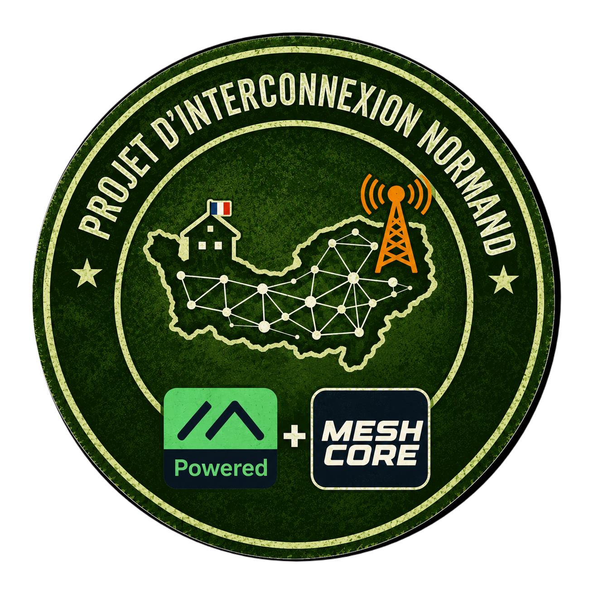

# Projet d’Interconnexion Normand — Wiki radio maillée

Bienvenue dans le wiki open source du **Projet d’Interconnexion Normand**. Ce guide accompagne les nouveaux arrivants qui souhaitent découvrir, configurer et exploiter un réseau radio maillé basé sur **Meshtastic** et **MeshCore**.

> **Objectif :** permettre à chacun de mettre en service un nœud, rejoindre proprement le réseau normand, comprendre les limites radio et contribuer à une infrastructure utile, documentée et respectueuse.

> **Évolution du projet :** le Projet d’Interconnexion Normand bascule progressivement vers **MeshCore**. Meshtastic reste documenté et utilisé pendant la période de transition. Les deux environnements doivent être configurés séparément, car ils ne sont pas directement interopérables.

## Parcours conseillé

1. Lire [les principes et règles du projet](docs/00-bienvenue.md).
2. Lire [l’historique du projet](docs/05-historique-du-projet.md).
3. Choisir son environnement avec [le guide Meshtastic ou MeshCore](docs/01-choisir-son-reseau.md).
4. Choisir son matériel avec [le guide matériel](docs/02-materiel.md).
5. Préparer son appareil avec [la checklist de mise en service](docs/01-checklist-materiel.md).
6. Choisir son logiciel : [Meshtastic](docs/meshtastic/01-demarrage.md) ou [MeshCore](docs/meshcore/01-demarrage.md).
7. Pour MeshCore en France, lire [les profils France / Normandie](docs/meshcore/03-profils-france-normandie.md).
8. Choisir un emplacement avec [le guide de couverture](docs/terrain/03-simulateurs-couverture.md).
9. Consulter [la carte interactive des nœuds](docs/map.html), lire [la procédure de recensement](docs/04-carte-interactive.md) et proposer son nœud.
10. Effectuer le [test de portée et de qualité radio](docs/terrain/01-test-radio.md).

## Choisir entre Meshtastic et MeshCore

- **Meshtastic** est souvent le chemin le plus simple pour débuter : application mobile mature, télémétrie, position, canaux et nombreux appareils compatibles.
- **MeshCore** propose une architecture légère avec des rôles explicites — Companion, Repeater et Room Server — adaptée aux déploiements où l’on veut maîtriser le routage et la consommation.

Les deux écosystèmes utilisent LoRa, mais ils ne sont pas automatiquement interopérables. Un appareil Meshtastic ne rejoint pas directement un réseau MeshCore sans passerelle ou projet spécifique.

## Carte des nœuds

La [carte interactive](docs/map.html) affiche uniquement les nœuds validés dans le fichier public `docs/data/nodes.json`. Pour ajouter un nœud, utilisez le modèle d’issue **Proposer un nœud sur la carte**. Publiez une position approximative, jamais l’adresse d’un domicile ou d’un relais sensible.

## Rejoindre la communauté

Pour poser une question, demander de l’aide ou échanger avec les membres du projet :

- [Serveur Discord du Projet d’Interconnexion Normand](https://discord.gg/HnAfYUSU82)
- E-mail du projet : [projet.interconnection.normand@gmail.com](mailto:projet.interconnection.normand@gmail.com)

## Règles essentielles

- Configurer la **région radio correcte** avant toute émission.
- Ne jamais publier une clé privée, une clé de canal ou un QR code de configuration.
- Ne pas installer de relais sur un terrain ou un bâtiment sans autorisation.
- Respecter les limites de puissance, de taux d’occupation et les autres règles applicables en France.
- Documenter les changements et préférer une configuration reproductible.

## Documentation

- [Bienvenue, vocabulaire et règles du projet](docs/00-bienvenue.md)
- [Historique du Projet d’Interconnexion Normand](docs/05-historique-du-projet.md)
- [Choisir entre Meshtastic et MeshCore](docs/01-choisir-son-reseau.md)
- [Quel matériel choisir ?](docs/02-materiel.md)
- [Checklist matériel et préparation](docs/01-checklist-materiel.md)
- [Meshtastic — démarrage](docs/meshtastic/01-demarrage.md)
- [Meshtastic — configuration normande](docs/meshtastic/02-configuration-projet.md)
- [Meshtastic — canaux et sécurité](docs/meshtastic/03-canaux-securite.md)
- [MeshCore — démarrage](docs/meshcore/01-demarrage.md)
- [MeshCore — profils France / Normandie](docs/meshcore/03-profils-france-normandie.md)
- [MeshCore — rôles et déploiement](docs/meshcore/02-roles-deploiement.md)
- [Dépannage commun](docs/03-depannage.md)
- [Carte interactive et recensement des nœuds](docs/04-carte-interactive.md)
- [Test radio de terrain](docs/terrain/01-test-radio.md)
- [Outils de simulation et couverture](docs/terrain/03-simulateurs-couverture.md)
- [Déployer un relais](docs/terrain/02-deployer-un-relais.md)

## Licence

Le contenu de ce wiki est publié sous [CC BY-SA 4.0](LICENSE). Les exemples et scripts sont également réutilisables sous [MIT](LICENSE-CODE), sauf indication contraire. Les marques Meshtastic et MeshCore appartiennent à leurs projets respectifs.
