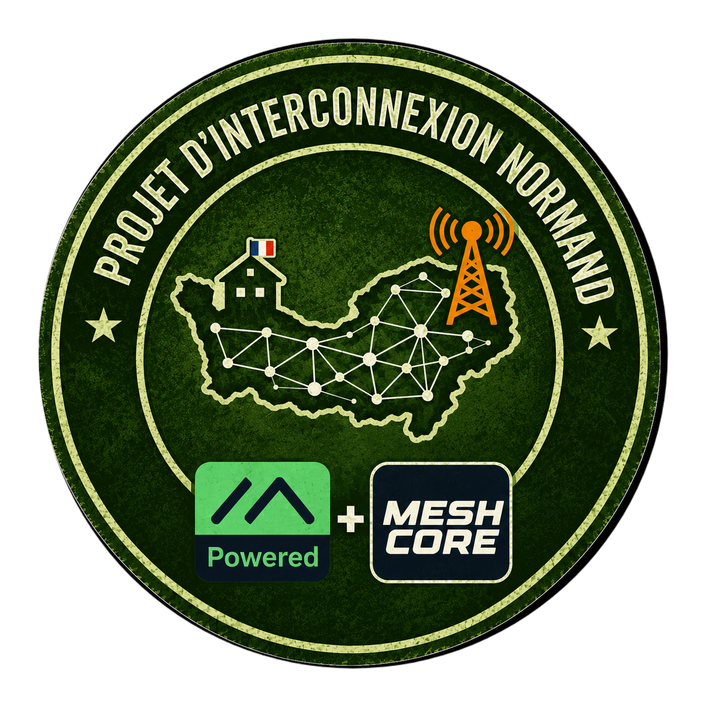
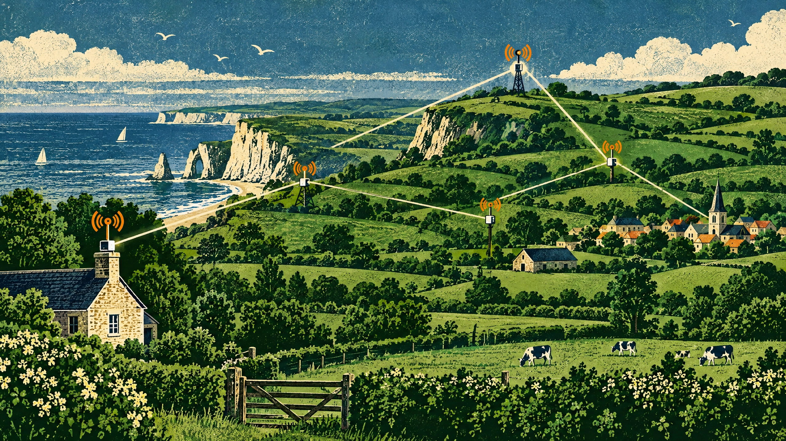

# Projet d’Interconnexion Normand — Wiki radio maillée

Bienvenue dans le wiki open source du **Projet d’Interconnexion Normand**. Ce guide accompagne les nouveaux arrivants qui souhaitent découvrir, configurer et exploiter un réseau radio maillé basé sur **Meshtastic** et **MeshCore**.

> **Objectif :** permettre à chacun de mettre en service un nœud, rejoindre proprement le réseau normand, comprendre les limites radio et contribuer à une infrastructure utile, documentée et respectueuse.

> **Besoin d’aide ?** Vous pouvez rejoindre à tout moment le [serveur Discord officiel du projet](https://discord.gg/HnAfYUSU82) ou écrire à [projet.interconnection.normand@gmail.com](mailto:projet.interconnection.normand@gmail.com). Il n’y a pas de question « trop débutante ».

> **Orientation du projet :** pour tout nouveau déploiement durable, tout nouveau répéteur et toute infrastructure régionale, le Projet d’Interconnexion Normand recommande désormais de partir sur **MeshCore**. Meshtastic reste documenté et utilisé pendant la période de transition, notamment pour les appareils existants et les usages mobiles ou ponctuels.

## Le projet en quelques mots

Le **Projet d’Interconnexion Normand** a pour ambition de connecter les personnes entre elles en toutes circonstances, y compris lorsque l’accès à Internet ou les réseaux mobiles sont interrompus. C’est une initiative open source et citoyenne qui expérimente des communications radio maillées en Normandie : des nœuds LoRa peuvent échanger des messages courts et, selon leur rôle et leur configuration, relayer ces messages de nœud en nœud.

L’objectif est de maintenir un lien local lorsque les moyens habituels ne fonctionnent plus, notamment lors d’événements météorologiques majeurs comme ceux cités par le projet — Irma ou Austen — ou lors d’une panne étendue des réseaux mobiles. À terme, le projet souhaite travailler avec les mairies, les collectivités et les services de secours afin de contribuer à tenir les habitants informés, dans un cadre autorisé, coordonné et complémentaire des réseaux professionnels.

Le projet s’adresse aux habitants, associations, clubs radio, établissements scolaires, mairies, intercommunalités, départements, propriétaires de points hauts et autres partenaires qui souhaitent apprendre, tester ou accueillir une expérimentation encadrée. Il peut servir à étudier la couverture radio, organiser un événement, relier temporairement des équipes de terrain ou créer un relais local autorisé.

Ce projet ne remplace ni les secours, ni les réseaux professionnels, ni les moyens réglementaires des collectivités. Il ne garantit pas une communication dans toutes les situations, ne promet pas une couverture partout et ne doit pas transporter de données sensibles. Sa valeur vient de la démarche : tester sur le terrain, mesurer les limites, documenter les résultats et transmettre les compétences pour construire une capacité locale supplémentaire.

### Pourquoi s’y intéresser ? Une vocation d’utilité publique

Le projet porte une **vocation d’intérêt général et d’utilité publique** : contribuer à maintenir un lien entre les personnes lorsque Internet ou les réseaux mobiles sont indisponibles, et aider les territoires à mieux se préparer à des situations de rupture. Une communication locale complémentaire peut être précieuse lors d’une tempête, d’une panne étendue, d’un événement ou d’un exercice, à condition d’être testée, autorisée et présentée avec ses limites.

- **Pour le territoire :** renforcer la résilience locale, identifier les zones blanches et mieux comprendre l’effet du relief, de la hauteur, des antennes et des obstacles.
- **Pour les habitants :** préserver un lien de proximité, découvrir la radio, participer à un projet citoyen concret et contribuer à une carte de couverture responsable.
- **Pour les personnes isolées :** disposer, lorsque la couverture le permet, d’un moyen complémentaire pour transmettre un message court ou une information de situation.
- **Pour les associations :** organiser des randonnées, événements, ateliers et activités de plein air avec un outil d’expérimentation adapté au terrain.
- **Pour les mairies et collectivités :** étudier une solution locale, sobre et documentée pouvant contribuer à informer les habitants, avant une éventuelle coopération avec les acteurs compétents.
- **Pour les services de secours :** ouvrir à terme un dialogue sur la complémentarité, les points hauts et les conditions d’une coopération encadrée, sans remplacer leurs réseaux ni leurs procédures.
- **Pour les partenaires techniques :** contribuer à une infrastructure open source, réutilisable, auditable et améliorable collectivement.

Cette formulation décrit la **finalité collective** du projet ; elle ne constitue pas automatiquement une reconnaissance administrative officielle d’utilité publique. Toute coopération institutionnelle doit être validée par les autorités et organismes concernés.

Le projet **bascule de plus en plus vers MeshCore** pour ses nouveaux déploiements durables et ses infrastructures régionales. Meshtastic reste utile pendant la transition, pour les appareils déjà en service et pour les usages mobiles ou ponctuels.

Pour une présentation complète destinée aux mairies, départements, intercommunalités et partenaires, consultez la page [Présentation aux collectivités et partenaires](docs/07-presentation-collectivites.md).

> **Envie d’en discuter ?** Rejoignez le [Discord officiel du projet](https://discord.gg/HnAfYUSU82) ou écrivez à [projet.interconnection.normand@gmail.com](mailto:projet.interconnection.normand@gmail.com). Les questions des débutants, des associations et des collectivités sont les bienvenues.

## Parcours conseillé

1. Pour une mairie, un département, une association ou un partenaire, lire [la présentation institutionnelle](docs/07-presentation-collectivites.md).
2. Commencer par le [guide débutant : mon premier nœud](docs/guide-debutant.md).
3. Lire [les principes et règles du projet](docs/00-bienvenue.md).
4. Lire [l’état actuel du projet](docs/06-etat-actuel.md) et [son historique](docs/05-historique-du-projet.md). Pour un nouveau déploiement, partez directement sur MeshCore.
5. Comprendre [les régions et scopes MeshCore](docs/meshcore/04-regions-et-scopes.md).
6. Choisir son matériel avec [le guide matériel](docs/02-materiel.md).
7. Préparer son appareil avec [la checklist de mise en service](docs/01-checklist-materiel.md).
8. Flasher son appareil avec le guide [Companion et Repeater](docs/meshcore/05-flasher-companion-repeater.md).
9. Choisir son logiciel : [Meshtastic](docs/meshtastic/01-demarrage.md) ou [MeshCore](docs/meshcore/01-demarrage.md).
10. Pour MeshCore en France, lire [les profils France / Normandie](docs/meshcore/03-profils-france-normandie.md).
11. Si vous utilisez un matériel solaire, lire [le guide SenseCAP P1-Pro](docs/meshcore/06-sensecap-p1-pro.md).
12. Choisir un emplacement avec [le guide de couverture](docs/terrain/03-simulateurs-couverture.md).
13. Consulter les [cartes officielles des nœuds et de la couverture](docs/04-carte-interactive.md) : MeshCore, RelayLens et MeshQual.
14. Effectuer le [test de portée et de qualité radio](docs/terrain/01-test-radio.md).

## Choisir entre Meshtastic et MeshCore

- **Meshtastic** est souvent le chemin le plus simple pour débuter : application mobile mature, télémétrie, position, canaux et nombreux appareils compatibles.
- **MeshCore** propose une architecture légère avec des rôles explicites — Companion, Repeater et Room Server — adaptée aux déploiements où l’on veut maîtriser le routage et la consommation.

Pour les nouveaux arrivants qui souhaitent contribuer à l’infrastructure normande, le choix recommandé est **MeshCore**. Meshtastic reste un excellent outil pour apprendre, se déplacer avec un Companion, participer à un événement ou conserver un appareil déjà configuré, mais les nouveaux répéteurs et les extensions régionales doivent suivre MeshCore.

Les deux écosystèmes utilisent LoRa, mais ils ne sont pas automatiquement interopérables. Un appareil Meshtastic ne rejoint pas directement un réseau MeshCore sans passerelle ou projet spécifique.

## Cartes officielles des nœuds

La carte locale GitHub a été retirée du parcours principal. Utilisez désormais les [cartes officielles et communautaires recommandées](docs/04-carte-interactive.md) : [map.meshcore.io](https://map.meshcore.io/?lat=7.0000&lon=25.0000&zoom=3), [RelayLens Companions](https://relaylens.mesh.chaun14.fr/companions), [MeshQual](https://meshqual.pmrs.fr/) et [MeshStats](https://meshstats.serveurperso.in/#/live). Ces services sont alimentés par des **Observers MeshCore** : des nœuds qui écoutent localement le réseau et remontent les données autorisées vers des outils d’analyse. Comparez les résultats et confirmez toujours la couverture par un test réel.

## Rejoindre la communauté

Pour poser une question, demander de l’aide ou échanger avec les membres du projet :

- [Serveur Discord du Projet d’Interconnexion Normand](https://discord.gg/HnAfYUSU82)
- E-mail du projet : [projet.interconnection.normand@gmail.com](mailto:projet.interconnection.normand@gmail.com)

## Règles essentielles

- Configurer la **région radio correcte** avant toute émission.
- Ne jamais publier une clé privée, une clé de canal ou un QR code de configuration.
- Ne pas installer de relais sur un terrain ou un bâtiment sans autorisation.
- Respecter les limites de puissance, de taux d’occupation et les autres règles applicables en France.
- Documenter les changements et préférer une configuration reproductible.

## Documentation

- [Bienvenue, vocabulaire et règles du projet](docs/00-bienvenue.md)
- [État actuel du projet et parcours recommandé](docs/06-etat-actuel.md)
- [Historique du Projet d’Interconnexion Normand](docs/05-historique-du-projet.md)
- [Guide débutant : mon premier nœud](docs/guide-debutant.md)
- [Flasher son Companion ou son Repeater MeshCore](docs/meshcore/05-flasher-companion-repeater.md)
- [Seeed Studio SenseCAP Solar Node P1-Pro](docs/meshcore/06-sensecap-p1-pro.md)
- [Choisir entre Meshtastic et MeshCore](docs/01-choisir-son-reseau.md)
- [Quel matériel choisir ?](docs/02-materiel.md)
- [Checklist matériel et préparation](docs/01-checklist-materiel.md)
- [Meshtastic — démarrage](docs/meshtastic/01-demarrage.md)
- [Meshtastic — configuration normande](docs/meshtastic/02-configuration-projet.md)
- [Meshtastic — canaux et sécurité](docs/meshtastic/03-canaux-securite.md)
- [MeshCore — démarrage](docs/meshcore/01-demarrage.md)
- [MeshCore — profils France / Normandie](docs/meshcore/03-profils-france-normandie.md)
- [MeshCore — régions et scopes](docs/meshcore/04-regions-et-scopes.md)
- [MeshCore — rôles et déploiement](docs/meshcore/02-roles-deploiement.md)
- [Dépannage commun](docs/03-depannage.md)
- [Carte interactive et recensement des nœuds](docs/04-carte-interactive.md)
- [Test radio de terrain](docs/terrain/01-test-radio.md)
- [Outils de simulation et couverture](docs/terrain/03-simulateurs-couverture.md)
- [Déployer un relais](docs/terrain/02-deployer-un-relais.md)

## Licence

Le contenu de ce wiki est publié sous [CC BY-SA 4.0](LICENSE). Les exemples et scripts sont également réutilisables sous [MIT](LICENSE-CODE), sauf indication contraire. Les marques Meshtastic et MeshCore appartiennent à leurs projets respectifs.
