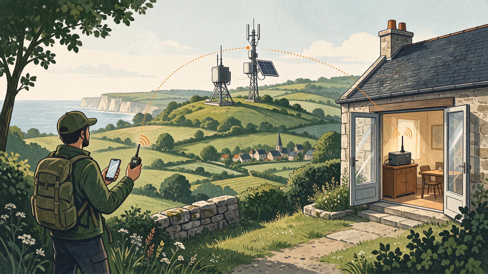

# Bienvenue dans le Projet d’Interconnexion Normand

Le Projet d’Interconnexion Normand documente et développe des communications radio LoRa maillées en Normandie. L’objectif est de permettre des échanges locaux complémentaires lorsque l’accès à Internet ou aux réseaux mobiles est dégradé. Le projet ne remplace pas les réseaux professionnels ni les services de secours et ne garantit pas la couverture ou la disponibilité.

Le wiki rassemble des pages courtes par sujet. Pour trouver rapidement la bonne information, utilisez le [plan du wiki par thème](explorer-le-wiki.html).

## Par où commencer ?

- Vous hésitez entre les logiciels ? Lisez [Choisir entre MeshCore et Meshtastic](01-choisir-son-reseau.html).
- Vous avez déjà un appareil ? Suivez le [guide du premier nœud](guide-debutant.html), puis le démarrage correspondant à [MeshCore](meshcore/01-demarrage.html) ou à [Meshtastic](meshtastic/01-demarrage.html).
- Vous voulez connaître l’orientation du réseau aujourd’hui ? Consultez [l’état actuel du projet](06-etat-actuel.html). Pour les étapes passées, ouvrez [l’historique](05-historique-du-projet.html).
- Un terme technique vous bloque ? Consultez le [glossaire](glossaire.html). Avant d’émettre ou de publier des informations, lisez les [bonnes pratiques de sécurité et de vie privée](securite-et-bonnes-pratiques.html).

## Orientation générale

Les nouvelles infrastructures durables du projet s’orientent vers MeshCore. Meshtastic reste documenté pour les appareils déjà déployés et pour les usages mobiles ou ponctuels. Les critères de choix sont détaillés dans la page de comparaison, et les décisions en vigueur sont regroupées dans la page sur l’[état actuel](06-etat-actuel.html).

Pour poser une question, rejoignez le [Discord du projet](https://discord.gg/HnAfYUSU82) ou écrivez à [projet.interconnection.normand@gmail.com](mailto:projet.interconnection.normand@gmail.com).
