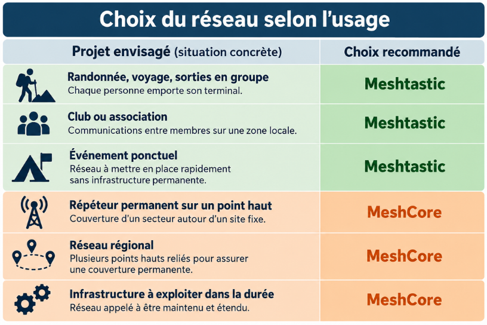

# Choisir entre Meshtastic et MeshCore

Le Projet d’Interconnexion Normand utilise encore les deux environnements pendant sa migration progressive. Pour toute nouvelle contribution à l’infrastructure normande, l’orientation recommandée est **MeshCore** ; Meshtastic reste pertinent pour certains usages mobiles ou ponctuels et pour les appareils déjà en service.

## Meshtastic pour les usages ponctuels

### Randonnée, voyage et sorties en groupe

Meshtastic est recommandé lorsque chaque personne emporte son terminal et que le réseau doit être immédiatement opérationnel. L’application mobile, la télémétrie et les nombreuses cartes compatibles facilitent la mise en route d’un groupe qui se déplace.

Chaque participant doit toutefois partager les réglages radio et le canal convenus. Une sortie ponctuelle ne justifie pas forcément l’installation d’un relais permanent.

### Club ou association locale

Pour des communications entre membres dans une zone locale, Meshtastic reste un choix simple pour commencer. Il convient aux essais, aux activités régulières et aux petits réseaux où les utilisateurs gèrent eux-mêmes leur appareil.

Documentez le canal, le preset, la région et la procédure d’accueil afin d’éviter que chaque nouveau membre reparte de zéro.

### Événement ponctuel

Pour un événement à mettre en place rapidement sans infrastructure permanente, Meshtastic permet de distribuer des appareils préconfigurés et de tester la couverture sur place. Prévoyez un canal dédié, une durée d’utilisation limitée et une procédure d’effacement des clés après l’événement.

## MeshCore pour les infrastructures durables

### Répéteur permanent sur un point haut

MeshCore est recommandé pour un répéteur installé durablement sur un site fixe. Le rôle Repeater, les réglages d’advert, les scopes et les outils de maintenance sont adaptés à une infrastructure qui doit fonctionner sans téléphone connecté en permanence.

Le site doit être autorisé, alimenté, accessible pour la maintenance et documenté. La configuration officielle des répéteurs normands est décrite dans [Profils MeshCore France / Normandie](meshcore/03-profils-france-normandie.md).

### Réseau régional

Lorsque plusieurs points hauts doivent être reliés pour assurer une couverture permanente, MeshCore devient le choix privilégié du projet. Les rôles, les scopes départementaux et le routage doivent être documentés et maintenus de façon homogène.

Un réseau régional ne se résume pas à installer plusieurs radios. Il faut définir les responsables, les profils radio, le suivi des versions, la surveillance, la récupération physique et la gestion des changements.

### Infrastructure à exploiter dans la durée

Pour un réseau appelé à être maintenu, étendu et transmis à de nouveaux membres, MeshCore offre le cadre privilégié par la trajectoire actuelle du projet. Les Companions servent les utilisateurs et les Repeaters assurent la couverture ; ces rôles ne doivent pas être mélangés sans décision documentée.

## Règle de décision rapide

Pour un nouveau membre, commencez par **MeshCore Companion** si votre objectif est de rejoindre durablement le réseau normand. Choisissez **Meshtastic** si vous partez en groupe, organisez une activité ponctuelle, devez rester compatible avec un parc existant ou voulez découvrir le principe avec un téléphone. Choisissez impérativement **MeshCore** si vous déployez un répéteur permanent, plusieurs points hauts ou une infrastructure régionale maintenue dans le temps.

Si vous hésitez, commencez par un Companion de test. Ne reflashez pas un appareil déjà déployé avant d’avoir vérifié le rôle, la sauvegarde, le profil radio et le relais que vous souhaitez rejoindre.

## Important pendant la migration

Meshtastic et MeshCore utilisent tous les deux LoRa mais ne sont pas directement interopérables. Un changement de logiciel ne doit donc pas être présenté comme une simple mise à jour : il peut modifier les canaux, les rôles, les chemins, les clés et la manière dont le réseau se comporte.

## Une question ?

Vous pouvez à tout moment rejoindre le [serveur Discord officiel du Projet d’Interconnexion Normand](https://discord.gg/HnAfYUSU82) ou nous contacter par e-mail à [projet.interconnection.normand@gmail.com](mailto:projet.interconnection.normand@gmail.com).
