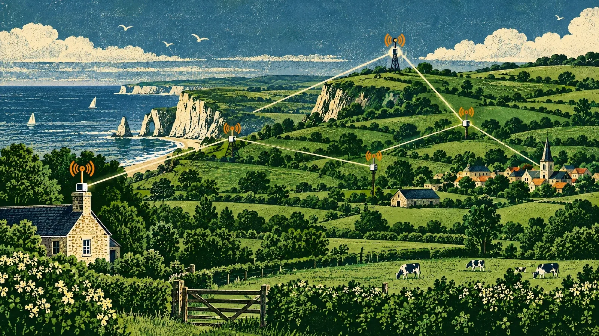
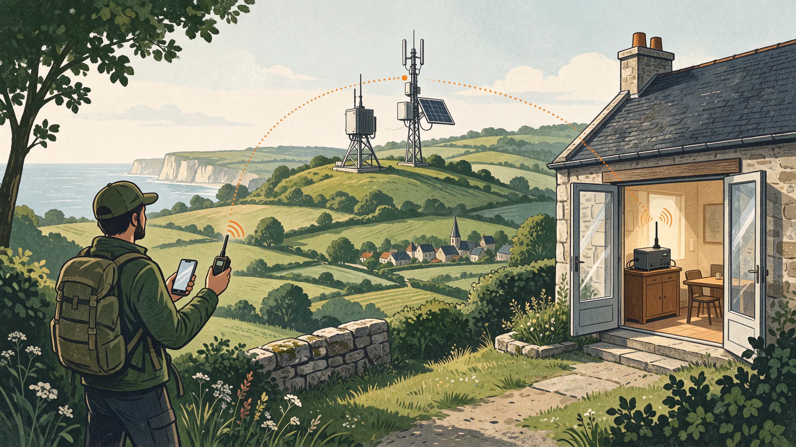

# Présentation du Projet d’Interconnexion Normand

## À l’attention des mairies, intercommunalités, départements, associations et partenaires locaux

Le **Projet d’Interconnexion Normand** a pour ambition de connecter les personnes entre elles en toutes circonstances, y compris lorsque l’accès à Internet ou les réseaux mobiles sont interrompus. C’est une initiative open source et citoyenne qui s’appuie sur des communications radio maillées en Normandie. Son objectif est de créer, avec les habitants, les associations, les collectivités et les propriétaires de sites, une infrastructure locale complémentaire pour échanger des messages courts et des informations de situation.

Le projet porte une **vocation d’intérêt général et d’utilité publique au sens de sa finalité collective** : contribuer à la résilience des territoires, au maintien du lien local et à la circulation d’informations utiles lorsque les moyens habituels sont dégradés. Pour donner une continuité concrète à cette ambition, il vise le déploiement progressif de **répéteurs fixes sur des sites autorisés**, leur entretien dans la durée et la documentation de leur couverture avec les habitants, les associations, les collectivités et les propriétaires de sites. Les reconnaissances, simulations et mesures de terrain servent à choisir et valider les emplacements : elles préparent un maillage durable et n’en sont pas la finalité.

Le projet repose sur des appareils LoRa basse consommation qui peuvent communiquer directement entre eux et relayer certains messages de nœud en nœud. Un appareil peut être utilisé par une personne — rôle **Companion** — ou installé sur un point fixe pour étendre la couverture — rôle **Repeater**.

 {: loading="lazy" decoding="async"}

> **Notre ambition :** bâtir, site après site, un maillage de répéteurs autorisés, installés pour durer, documentés et entretenus avec les partenaires locaux.

## Une capacité locale à construire dans la durée

Lorsqu’une tempête majeure — comme les événements cités par le projet, **Irma ou Austen** — ou une panne étendue perturbe l’électricité, Internet ou les réseaux mobiles, les habitants peuvent perdre une partie de leurs moyens habituels pour échanger. Des répéteurs fixes, implantés sur des sites adaptés et suivis dans la durée, peuvent offrir un moyen complémentaire de communiquer entre personnes équipées, bénévoles, associations et équipes locales. Le maillage se construit progressivement ; sa disponibilité dépend de la couverture radio, de l’alimentation et de l’état des équipements.

Cette ambition ne constitue pas une promesse de fonctionnement dans toutes les circonstances. La portée dépend du relief, des antennes, de l’alimentation, des points hauts, de la météo et de la maintenance. Les messages doivent rester courts, non sensibles et adaptés à un réseau communautaire.

Les **mairies, intercommunalités et départements** peuvent contribuer dès maintenant à la construction du maillage : proposer un point haut, faciliter les autorisations et l’accès au site, ou participer aux conditions d’installation et de maintenance. Toute coopération avec les services de secours ou les autorités compétentes doit être définie avec eux, en complément des réseaux professionnels et des procédures officielles — jamais en remplacement de ceux-ci.

## Pourquoi s’y intéresser ? Une vocation d’utilité publique

Le Projet d’Interconnexion Normand porte une **vocation d’intérêt général et d’utilité publique** : contribuer à ce que les personnes puissent continuer à se parler et à recevoir des informations utiles lorsque les moyens habituels deviennent indisponibles. Cette mission prend tout son sens dans les territoires ruraux, le bocage, le littoral, les vallées, les forêts, les bourgs éloignés et les secteurs où la couverture mobile peut être inégale.

Un réseau local soutenu par des répéteurs installés et entretenus dans la durée peut aider à maintenir un lien entre habitants, bénévoles, associations, équipes municipales et acteurs de terrain. Le projet ne promet pas que chaque message passera dans toutes les situations ; il développe progressivement cette capacité complémentaire et en documente les limites pour renforcer la résilience du territoire.

### Une utilité concrète pour chacun

- **Pour le territoire :** mieux comprendre les zones blanches, les effets du relief, de la hauteur, des antennes et des obstacles afin d’identifier des solutions locales de continuité.
- **Pour les habitants :** préserver un moyen de lien de proximité, découvrir la radio, participer à une démarche citoyenne et contribuer à une carte de couverture responsable.
- **Pour les personnes isolées ou éloignées :** disposer, lorsque la couverture le permet, d’un moyen complémentaire pour transmettre un message court, un point de rendez-vous ou une information de situation.
- **Pour les associations :** organiser des randonnées, événements, ateliers et activités de plein air en s’appuyant sur un réseau local et ses répéteurs durables.
- **Pour les collectivités :** contribuer concrètement au maillage durable en proposant un site d’accueil, en facilitant les autorisations et en participant, selon leurs possibilités, à l’installation, à l’alimentation ou à la maintenance d’un répéteur permanent.
- **Pour les mairies et départements :** s’appuyer sur un réseau citoyen complémentaire, documenté et encadré, qui pourrait relayer des informations publiques non sensibles selon des procédures définies avec les acteurs compétents.
- **Pour les services de secours :** ouvrir à terme un dialogue sur la complémentarité, la cartographie des points hauts et les conditions strictes d’une éventuelle coopération — sans remplacer leurs réseaux ni leurs procédures.
- **Pour les partenaires techniques :** contribuer à une infrastructure open source, réutilisable, auditable et améliorable collectivement.
- **Pour les jeunes et les établissements scolaires :** apprendre concrètement les bases de la radio, de l’énergie, de la cartographie, de la coopération et de la gestion responsable de l’information.

L’utilité collective du projet se construit dans des réalisations concrètes : des répéteurs autorisés installés et suivis, des zones de couverture mieux documentées, des personnes formées, des procédures de maintenance partagées et des partenaires engagés dans la durée. Chaque site pérenne et chaque contribution documentée renforcent la connaissance et le maillage du territoire.

> **Précision importante :** l’expression « vocation d’utilité publique » décrit la finalité collective du projet. Elle ne signifie pas que l’association ou l’initiative bénéficie automatiquement d’une reconnaissance administrative officielle d’utilité publique. Toute coopération institutionnelle doit être validée par les autorités et organismes concernés.

Il ne s’agit pas de promettre une couverture partout ni de remplacer les services de secours, les réseaux professionnels ou les moyens réglementaires des collectivités. Le projet vise un **maillage citoyen d’intérêt général, construit progressivement par des installations autorisées et maintenables**. Les études et mesures servent à choisir les implantations et à en expliquer les limites ; chaque déploiement doit être encadré par des responsabilités claires avant tout usage institutionnel.

## En quoi consiste concrètement le réseau ?

Un réseau maillé est composé de plusieurs nœuds radio. Chaque nœud peut recevoir ou transmettre des messages selon son rôle, son logiciel, sa configuration et sa position.

### Le Companion

Le Companion est le nœud utilisé par une personne. Il peut être relié à un téléphone ou à un ordinateur selon le matériel. Il sert à envoyer et recevoir des messages, à réaliser des essais de couverture et à participer à la vie du réseau.

### Le Repeater

Le Repeater est un nœud fixe installé sur un emplacement autorisé. Il est placé en hauteur lorsque cela est possible, avec une antenne adaptée et une alimentation stable. Il relaie des paquets pour améliorer la couverture d’un secteur.

Un Repeater n’est pas un simple appareil que l’on pose n’importe où. Son installation nécessite une autorisation, une personne responsable, une procédure de maintenance et une évaluation des risques.

### MeshCore pour les répéteurs permanents

Pour les installations durables présentées aux collectivités, le projet s’appuie sur **MeshCore**.

MeshCore est retenu pour les infrastructures durables, les nouveaux Repeaters et le développement du réseau régional normand. Le déploiement progressif permet de valider les profils radio, de documenter les configurations et d’accompagner les utilisateurs tout en maintenant une architecture cohérente.

## Quels bénéfices pour une collectivité ?

### Une contribution durable au réseau

Une collectivité peut contribuer en accueillant un répéteur permanent sur un bâtiment, un équipement ou un point haut autorisé. Les premières mesures servent à vérifier l’emplacement et la couverture visée ; dès le départ, le site est pensé pour durer, avec un accès de maintenance, une alimentation adaptée et un partenaire local identifié.

### Une démarche pédagogique

Les habitants et agents intéressés peuvent apprendre les bases de la radio, des antennes, du relief, de la documentation et de la maintenance. Le matériel et les procédures sont expliqués dans un wiki public, ce qui facilite la transmission des connaissances.

### Une approche sobre

Les nœuds LoRa peuvent fonctionner avec une faible consommation électrique. Certains équipements solaires, comme le SenseCAP Solar Node P1-Pro, peuvent être étudiés pour des installations autonomes lorsque le site et la maintenance le permettent.

### Une infrastructure documentée

Chaque installation sérieuse doit être décrite : emplacement général, responsable, modèle, firmware, antenne, alimentation, date du dernier contrôle de fonctionnement et procédure de récupération. Cette documentation limite la dépendance à une seule personne.

### Une démarche open source

Les guides, procédures et exemples sont publiés sur GitHub. Les contributions peuvent être relues, corrigées et améliorées collectivement. Une collectivité peut ainsi comprendre ce qui est installé et ne dépend pas d’une solution opaque.

## Exemples de cas d’usage

Les cas d’usage doivent être définis avec les acteurs locaux et rester proportionnés aux capacités réelles du réseau.

- **Événement communal ou associatif :** permettre à une équipe de bénévoles de rester en lien grâce à des messages courts sur un parcours ou une zone définie.
- **Randonnée ou activité de plein air :** maintenir un lien entre plusieurs groupes équipés de Companions.
- **Observation de couverture :** parcourir une commune, relever les zones où les messages passent et documenter les limites.
- **Appui logistique non critique :** échanger un point de rendez-vous, une demande de matériel ou une information d’organisation.
- **Répéteur permanent sur un point haut :** maintenir une couverture locale et servir de point d’appui au développement progressif du maillage.
- **Atelier citoyen ou scolaire :** faire découvrir les ondes radio, le maillage, l’énergie et la cartographie de terrain.
- **Réseau associatif local :** relier temporairement ou durablement des membres dans une zone où la téléphonie n’est pas le seul moyen souhaité.

Les messages ne doivent pas contenir de données médicales, de secrets, de clés privées ou d’informations dont la divulgation pourrait mettre une personne ou un site en danger.

## Comment une collectivité peut s’impliquer ?

### 1. Prendre contact

Présentez votre territoire, le besoin de couverture, les sites que vous pourriez accueillir dans la durée et les formes de contribution envisageables. Il n’est pas nécessaire de connaître LoRa ou MeshCore avant le premier échange.

Vous pouvez rejoindre le [serveur Discord officiel du Projet d’Interconnexion Normand](https://discord.gg/HnAfYUSU82) ou écrire à [projet.interconnection.normand@gmail.com](mailto:projet.interconnection.normand@gmail.com).

### 2. Choisir une première zone avec un objectif durable

Commencez par une commune, un quartier ou une liaison que des répéteurs permanents pourraient améliorer. Il n’est pas nécessaire d’équiper tout le territoire d’emblée : un premier site autorisé, accueilli et maintenu dans la durée peut devenir la première brique du réseau, plutôt qu’une installation temporaire sans suite.

### 3. Identifier les responsabilités

Avant toute installation, clarifiez les engagements qui permettront de maintenir le relais dans la durée :

- qui autorise l’accès au site et pour quelle durée ;
- qui met à disposition, possède ou finance le matériel ;
- qui configure le nœud et tient la documentation à jour ;
- qui assure les vérifications et intervient en cas de panne ;
- qui décide si la position du site peut être publiée ;
- quelles sont les conditions de renouvellement, de maintenance ou de retrait du matériel ;
- quel interlocuteur local suit l’installation dans le temps.

### 4. Faire une étude radio simple

Comparez plusieurs emplacements avec les outils disponibles, puis réalisez les mesures de terrain nécessaires pour valider le site et l’antenne. La hauteur, la ligne de vue, les obstacles, les parasites et l’alimentation comptent souvent davantage que la puissance annoncée sur une fiche produit. Cette vérification prépare une installation fixe fiable et maintenable.

Le projet peut s’appuyer sur les outils de couverture et de simulation MeshCore lorsque ceux-ci sont adaptés au cas étudié.

### 5. Valider le site, puis installer pour durer

Vérifiez le matériel et la configuration, puis effectuez les mesures de couverture utiles avant la pose définitive. Une fois le site autorisé et adapté, planifiez l’installation permanente, son alimentation, son responsable et sa maintenance. Si les résultats sont insuffisants, ajustez l’antenne ou l’emplacement : l’objectif reste de créer un relais utile dans la durée. Une simulation ne garantit jamais la couverture.

### 6. Documenter et assurer le suivi

Après l’installation, consignez le site, le matériel, l’alimentation, le responsable, les vérifications périodiques, les incidents et les zones couvertes. Ce suivi permet d’organiser la maintenance, de faire évoluer le maillage et de transmettre les responsabilités si les interlocuteurs changent.

## Sécurité, vie privée et responsabilités

Le projet applique quelques règles essentielles :

- aucune installation sur un terrain, un toit ou un bâtiment sans autorisation ;
- aucune promesse de disponibilité, de confidentialité absolue ou de secours garanti ;
- aucune clé privée, clé de canal, QR code ou donnée sensible dans une issue ou une capture ;
- aucune publication de position exacte d’un domicile, d’un site sensible ou d’un relais vulnérable ;
- aucun travail en hauteur sans compétence, équipement et autorisation adaptés ;
- respect de la réglementation radio applicable en France et des paramètres autorisés ;
- possibilité de couper, récupérer ou retirer un nœud qui présente un risque.

Les positions publiées sur la carte communautaire doivent être approximatives lorsque la précision créerait un risque. La participation est volontaire et chaque acteur doit pouvoir demander la correction ou le retrait d’une information qui le concerne.

## Ce que le projet demande aux partenaires

Nous recherchons en priorité des partenaires prêts à contribuer à une infrastructure qui s’inscrit dans la durée :

- accueillir un répéteur permanent sur un site autorisé ;
- aider à identifier des points hauts accessibles et adaptés ;
- faciliter l’accès, l’alimentation et la sécurisation de l’installation ;
- contribuer, selon les possibilités du partenariat, au matériel, à la pose ou à la maintenance ;
- désigner un interlocuteur local et organiser le suivi ;
- contribuer aux vérifications initiales, aux relevés périodiques et à la documentation ;
- participer à la formation et à la transmission des compétences.

Un premier site bien choisi et maintenu peut constituer une brique durable du maillage. L’objectif est d’agrandir le réseau au rythme des partenaires et des sites réellement disponibles, pas d’accumuler des démonstrations sans continuité.

## Proposition de premier rendez-vous

Pour commencer, nous pouvons échanger sur :

1. le besoin local et le public concerné ;
2. la zone géographique et les obstacles connus ;
3. les sites éventuellement disponibles ;
4. le rôle des bénévoles, agents et associations ;
5. les conditions d’accueil du site, la durée visée et la contribution éventuelle aux coûts d’installation et de maintenance ;
6. les règles de sécurité et de confidentialité ;
7. les critères qui permettront de décider de la suite.

Pour les étapes d’étude, d’accueil et de maintenance d’un site, consultez aussi le [guide pratique pour accueillir un répéteur permanent](collectivites-relais.html).

## Intéressé ?

Le projet est ouvert aux collectivités, aux associations, aux clubs radio, aux établissements scolaires, aux habitants et aux personnes qui souhaitent contribuer. Une première discussion peut déboucher sur l’accueil d’un répéteur permanent, le renforcement d’un secteur ou un partenariat local de long terme.

- Rejoignez le [Discord officiel du Projet d’Interconnexion Normand](https://discord.gg/HnAfYUSU82).
- Écrivez à [projet.interconnection.normand@gmail.com](mailto:projet.interconnection.normand@gmail.com).
- Consultez le [guide débutant](./guide-debutant.html) pour comprendre le parcours technique.
- Consultez les [profils MeshCore France / Normandie](./meshcore/03-profils-france-normandie.html) pour les nouveaux déploiements.
- Consultez la [procédure de déploiement d’un relais](./terrain/02-deployer-un-relais.html) avant toute installation fixe.

> **Une infrastructure utile se construit dans la durée : un site autorisé, un répéteur maintenu et un partenaire local engagé renforcent concrètement le maillage normand.**