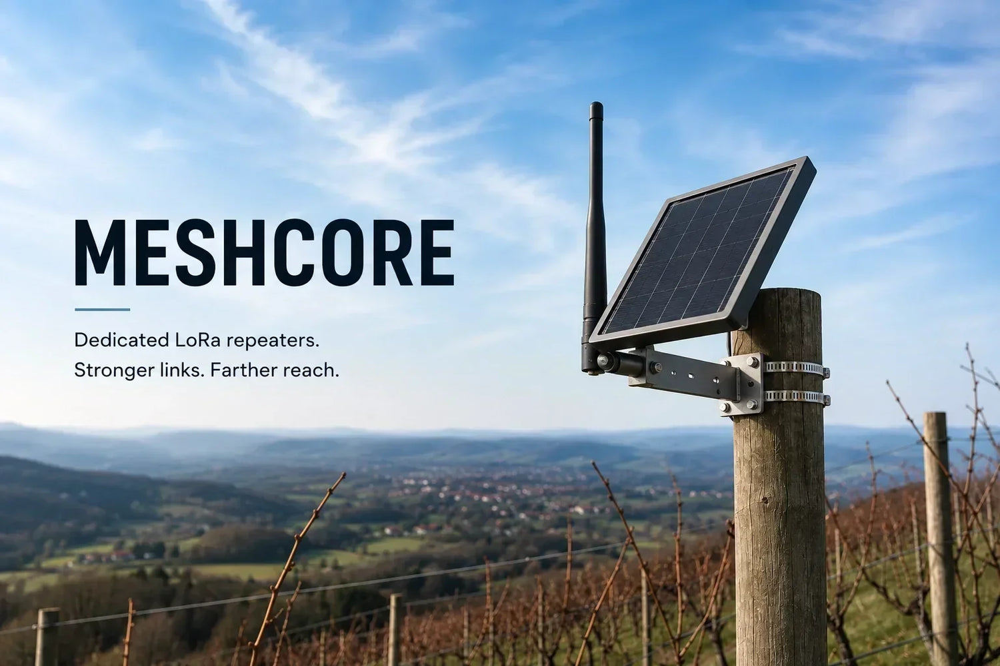
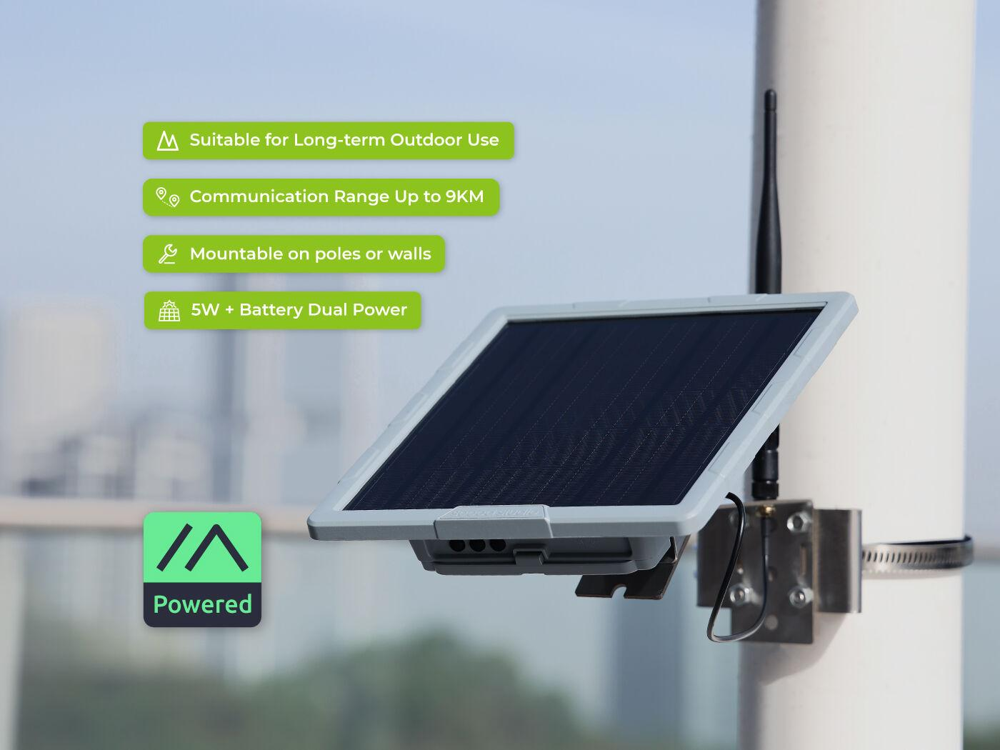
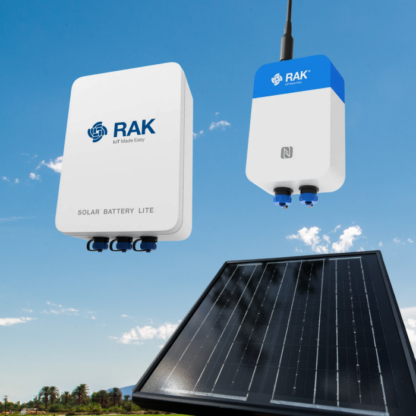
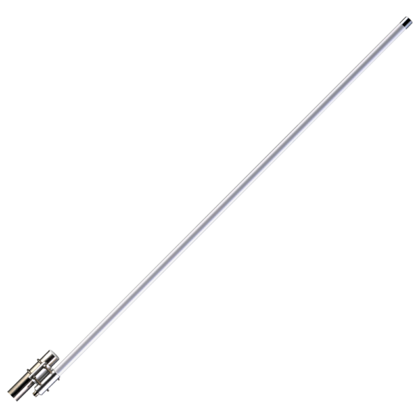
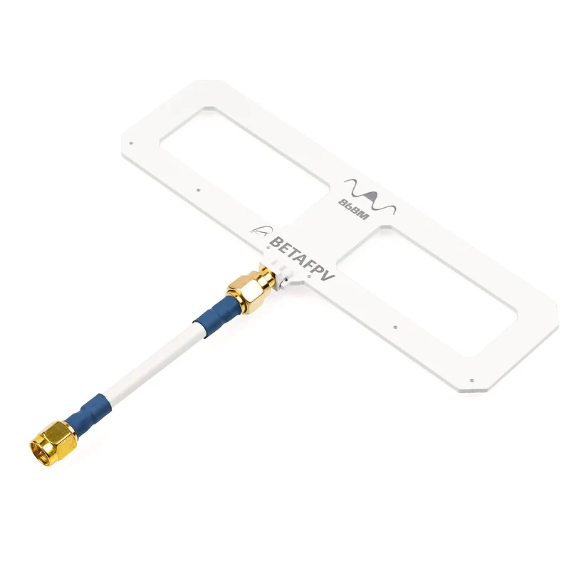

# Matériel, antennes et installations MeshCore

Cette page rassemble des exemples visuels et des recommandations pour choisir un nœud MeshCore, une antenne et un emplacement de répéteur. Les photos servent à reconnaître les familles de matériel et les principes d’installation ; elles ne constituent pas une validation automatique d’un modèle ou d’un site.

## À quoi ressemble une installation sur un point haut ?

*Exemple visuel d’un répéteur solaire installé sur un support élevé. Source de l’illustration : [SmartnMagic — MeshCore Repeater Node](https://smartnmagic.com/blogs/solutions/meshcore-repeater-node).*

Un point haut utile n’est pas forcément le sommet le plus élevé. Il doit surtout apporter une ligne de vue dégagée vers la zone à relier, rester accessible pour la maintenance et être autorisé par le propriétaire. Avant toute installation, vérifiez :

- la hauteur et les obstacles autour du site ;
- l’orientation et la verticalité de l’antenne ;
- la longueur et la qualité du câble coaxial ;
- l’exposition au vent, à la pluie, au gel et à la foudre ;
- l’alimentation et l’autonomie hivernale si le nœud est solaire ;
- l’accès physique pour récupérer ou redémarrer l’équipement ;
- l’autorisation écrite du propriétaire du toit, du mât ou du terrain.

La hauteur améliore souvent la ligne de vue, mais elle ne garantit pas une portée donnée. Les résultats doivent être confirmés par une simulation puis un test radio réel.

## Exemples de nœuds et de répéteurs

### Seeed SenseCAP Solar Node P1-Pro

Le [SenseCAP Solar Node P1-Pro pour MeshCore](https://www.seeedstudio.com/SenseCAP-Solar-Node-P1-Pro-for-Meshcore-p-6741.html) est un nœud extérieur solaire avec GPS, batterie et support de fixation. La fiche Seeed indique une compatibilité MeshCore Repeater, un panneau solaire de 5 W, quatre batteries 18650 et une antenne fournie 2 dBi pour 868–915 MHz. La page Seeed précise aussi que le produit MeshCore est livré avec le firmware Repeater pré-flashé ; vérifiez toutefois le firmware réellement présent avant la mise en service.

C’est un candidat pratique pour un relais autonome, à condition de prévoir un site autorisé, une orientation solaire correcte, une maintenance et une vérification de l’autonomie en hiver.

### RAK WisMesh Repeater

Le [RAK WisMesh Repeater](https://store.rakwireless.com/products/wismesh-meshtastic-solar-repeater) est un exemple de boîtier extérieur solaire conçu pour des déploiements fixes de réseaux LoRa. La fiche RAK le présente principalement pour Meshtastic ; avant de l’acheter pour le Projet d’Interconnexion Normand, vérifiez la compatibilité exacte du modèle et du firmware dans le [Web Flasher MeshCore](https://flasher.meshcore.io/).

Un produit annoncé pour Meshtastic n’est pas automatiquement compatible avec MeshCore. Le modèle exact, la puce, la mémoire, le rôle et la version firmware doivent être vérifiés séparément.

### Companion pour commencer

Pour un premier arrivant, privilégiez un Companion supporté par MeshCore : appareil portable, Bluetooth ou USB, antenne correctement accordée et batterie surveillée. Ne transformez pas votre seul Companion en Repeater : un relais fixe est une infrastructure dédiée, avec une alimentation, un site et un responsable de maintenance.

Consultez [le guide matériel général](./02-materiel.html) et [le guide de flash Companion / Repeater](./meshcore/05-flasher-companion-repeater.html) avant tout achat ou flash.

## Matériel conseillé pour MeshCore et Meshtastic

Voici les appareils que je conseille selon l’usage. Les quatre modèles ci-dessous sont compatibles avec Meshtastic et MeshCore lorsque le firmware correspondant à leur révision est installé. Un appareil n’exécute qu’un seul firmware mesh à la fois, et les deux protocoles ne communiquent pas directement entre eux. Les versions vendues peuvent arriver avec des firmwares différents : vérifiez le choix au moment de l’achat. En France, choisissez la variante radio **868 MHz / EU868** et le firmware adapté.

### SenseCAP Solar Node P1-Pro — relais solaire fixe

Seeed propose le P1-Pro avec le firmware Meshtastic ou avec le firmware Repeater MeshCore préinstallé. Il s’agit d’un candidat pour un nœud extérieur fixe : le fabricant indique un panneau solaire de 5 W, quatre batteries 18650, un GPS L76K et une radio SX1262. Choisissez la version correspondant au réseau voulu : [P1-Pro Meshtastic][1] ou [P1-Pro MeshCore][2]. [3]

### LILYGO T-Beam — expérimentation et nœud mobile

Le T-Beam réunit une radio LoRa, un GPS, un écran OLED selon l’option choisie et un support de batterie 18650. La fiche propose plusieurs bandes : prenez la version **868 MHz** pour un usage en France ; selon la carte, la batterie peut être à fournir et l’écran à souder. Meshtastic et MeshCore publient des firmwares pour des révisions T-Beam compatibles, notamment les variantes SX1262 et T-Beam 1.2 SX1276 : sélectionnez la cible correspondant exactement à la carte. [Le T-Beam chez LILYGO][4] [5] [6]

### LILYGO T-Echo SoftRF — format portable basse consommation

Le T-Echo est compact et intègre un écran à encre électronique, un GPS, une radio SX1262 et une batterie. Le lien fourni correspond à la variante **SoftRF préinstallée** : SoftRF est un firmware distinct, donc il faut installer Meshtastic ou MeshCore avant de l’utiliser dans l’un de ces réseaux. Le matériel T-Echo est pris en charge par les deux firmwares ; choisissez la variante radio 868 MHz et la cible T-Echo appropriée. [T-Echo SoftRF chez LILYGO][7] [8] [9] [5]

### Seeed Wio Tracker L1 Pro — Companion portable prêt à l’emploi

Le Wio Tracker L1 Pro associe une radio SX1262, un GPS L76K, un écran OLED de 1,3 pouce et une batterie intégrée de 2 000 mAh. Seeed vend une version préchargée MeshCore Companion et une autre préchargée Meshtastic : [Wio Tracker L1 Pro MeshCore][10] ou [Wio Tracker L1 Pro Meshtastic][11]. Vérifiez le firmware indiqué sur la fiche afin de recevoir la variante souhaitée.

[1]: https://www.seeedstudio.com/SenseCAP-Solar-Node-P1-Pro-for-Meshtastic-LoRa-p-6412.html "Seeed Studio — SenseCAP Solar Node P1-Pro pour Meshtastic"
[2]: https://www.seeedstudio.com/SenseCAP-Solar-Node-P1-Pro-for-Meshcore-p-6741.html "Seeed Studio — SenseCAP Solar Node P1-Pro pour MeshCore"
[3]: https://meshtastic.org/docs/hardware/devices/seeed-studio/sensecap/solar-node/ "Meshtastic — documentation SenseCAP Solar Node"
[4]: https://www.lilygo.cc/products/t-beam-meshtastic?bg_ref=H49A0e6lBD "LILYGO — T-Beam Meshtastic"
[5]: https://wiki.lilygo.cc/open-source/meshcore/ "LILYGO — appareils compatibles MeshCore"
[6]: https://meshtastic.org/docs/hardware/devices/lilygo/tbeam/ "Meshtastic — documentation T-Beam"
[7]: https://www.lilygo.cc/products/t-echo-softrf-firmware?bg_ref=H49A0e6lBD "LILYGO — T-Echo avec firmware SoftRF"
[8]: https://wiki.lilygo.cc/products/t-echo-series/t-echo/ "LILYGO — documentation T-Echo"
[9]: https://meshtastic.org/docs/hardware/devices/lilygo/techo/ "Meshtastic — documentation T-Echo"
[10]: https://www.seeedstudio.com/Wio-Tracker-L1-Pro-for-Meshcore-p-6717.html "Seeed Studio — Wio Tracker L1 Pro pour MeshCore"
[11]: https://www.seeedstudio.com/Wio-Tracker-L1-Pro-p-6454.html "Seeed Studio — Wio Tracker L1 Pro pour Meshtastic"
[12]: https://betafpv.com/products/betafpv-moxon-antenna "BETAFPV — spécifications de l’antenne Moxon"
[13]: https://www.unmannedtechshop.co.uk/fr/products/betafpv-moxon-antenna-2x-pack-2-4ghz-868mhz?variant=56578243199357&country=FR&currency=GBP "Unmanned Tech Shop — pack Moxon BETAFPV, variante 868 MHz"

## Antennes recommandées en 868 MHz

### Recommandation simple pour un Companion

Pour un appareil portable ou un premier test, utilisez l’antenne fournie par le fabricant si elle couvre bien la bande 868 MHz et si elle est correctement raccordée. Une antenne courte 1/4 d’onde autour de 2 dBi est souvent plus cohérente qu’une antenne de grande taille mal accordée.

### Recommandation pour un Repeater fixe polyvalent

Pour un Repeater qui doit couvrir plusieurs directions, choisissez en priorité une **antenne verticale omnidirectionnelle 50 Ω**, prévue pour l’extérieur et couvrant la bande européenne autour de 868 MHz. Un modèle de gain modéré, environ 3 à 8 dBi selon la géométrie du site, est généralement plus facile à intégrer qu’une antenne très directive.

*Exemple de famille d’antenne omnidirectionnelle extérieure : [Taoglas Barracuda OMB.868.B08F21](https://www.taoglas.com/product/barracuda-omb-868-08f21-868mhz-8dbi-omni-directional-outdoor-antenna/). La fiche fabricant indique une antenne colinéaire 868 MHz, un montage mât/mur, un connecteur N femelle et une protection IP65. Vérifiez le gain réellement retenu, la fréquence et le bilan de liaison avant achat.*

Pour la Normandie, une antenne omnidirectionnelle verticale est le choix de départ le plus polyvalent pour un point haut qui doit desservir plusieurs azimuts. Le gain le plus élevé n’est pas toujours le meilleur : le diagramme vertical devient plus étroit, les zones proches peuvent être moins bien desservies et les efforts au vent augmentent.

### Antenne directionnelle BETAFPV Moxon pour une liaison ciblée

*La variante choisie est le [pack de deux BETAFPV Moxon 868 MHz](https://www.unmannedtechshop.co.uk/fr/products/betafpv-moxon-antenna-2x-pack-2-4ghz-868mhz?variant=56578243199357&country=FR&currency=GBP). La fiche BETAFPV annonce un gain de 5,7 dBi vers l’avant, un câble de 72 mm et un connecteur SMA mâle. [12] [13]*

Cette antenne directionnelle peut convenir à une liaison ciblée : orientez l’avant vers le correspondant et vérifiez que le connecteur SMA s’adapte à votre nœud. La fiche BETAFPV ne précise pas d’indice d’étanchéité : pour une pose permanente à l’extérieur, prévoyez une protection contre les intempéries sans masquer l’antenne.

## Checklist antenne et coaxial

Avant de mettre sous tension :

- l’antenne est compatible avec la bande 868 MHz et l’impédance 50 Ω ;
- le connecteur de l’antenne correspond au câble et au nœud ;
- le câble coaxial est le plus court possible et adapté à la fréquence ;
- les connecteurs extérieurs sont protégés contre l’humidité ;
- l’antenne est verticale pour une couverture omnidirectionnelle ;
- le radiateur est éloigné des pièces métalliques et des panneaux solaires ;
- le mât, la fixation et le boîtier résistent au vent ;
- une protection contre les surtensions et la foudre est étudiée pour les sites exposés ;
- le nœud est testé sur table avant la pose en hauteur.

Ne changez pas d’antenne pour compenser une mauvaise position sans mesurer le résultat. Une antenne mieux accordée, un câble plus court ou quelques mètres de hauteur peuvent être plus utiles qu’un gain annoncé plus important.

## Choisir selon le scénario normand

| Scénario | Choix de départ | Pourquoi |
|---|---|---|
| Premier Companion | Antenne fournie ou 1/4 d’onde 868 MHz autour de 2 dBi | Simple, légère et adaptée aux déplacements |
| Repeater fixe couvrant plusieurs directions | Omnidirectionnelle verticale extérieure 3–8 dBi | Compromis entre couverture, installation et diagramme vertical |
| Liaison entre deux points identifiés | Directionnelle 868 MHz | Gain dans un secteur précis, nécessite alignement |
| Site solaire isolé | Nœud extérieur autonome + antenne adaptée + batterie dimensionnée | Réduit la dépendance au secteur, mais demande une maintenance saisonnière |
| Site urbain ou proche de structures métalliques | Antenne modérée et test de plusieurs positions | Limite les effets de masque et de réflexions |

## Sources et crédits des images

- Installation sur point haut : [SmartnMagic — MeshCore Repeater Node](https://smartnmagic.com/blogs/solutions/meshcore-repeater-node).
- SenseCAP P1-Pro : [Seeed Studio — fiche officielle](https://www.seeedstudio.com/SenseCAP-Solar-Node-P1-Pro-for-Meshcore-p-6741.html).
- RAK WisMesh Repeater : [RAKwireless — fiche officielle](https://store.rakwireless.com/products/wismesh-meshtastic-solar-repeater).
- Antenne omnidirectionnelle : [Taoglas Barracuda OMB.868.B08F21](https://www.taoglas.com/product/barracuda-omb-868-08f21-868mhz-8dbi-omni-directional-outdoor-antenna/).
- Antenne directionnelle BETAFPV Moxon 868 MHz : [fiche fabricant](https://betafpv.com/products/betafpv-moxon-antenna) et [pack 2 antennes, variante 868 MHz](https://www.unmannedtechshop.co.uk/fr/products/betafpv-moxon-antenna-2x-pack-2-4ghz-868mhz?variant=56578243199357&country=FR&currency=GBP).

Les visuels de fabricants restent soumis aux conditions de leurs ayants droit. Ils sont utilisés ici pour la documentation et l’identification des produits ; vérifiez les conditions de réutilisation avant toute redistribution commerciale.

## Besoin d’aide ?

Pour choisir un matériel, une antenne ou un emplacement, posez votre question sur le [Discord officiel du Projet d’Interconnexion Normand](https://discord.gg/HnAfYUSU82) ou par e-mail à [projet.interconnection.normand@gmail.com](mailto:projet.interconnection.normand@gmail.com).
