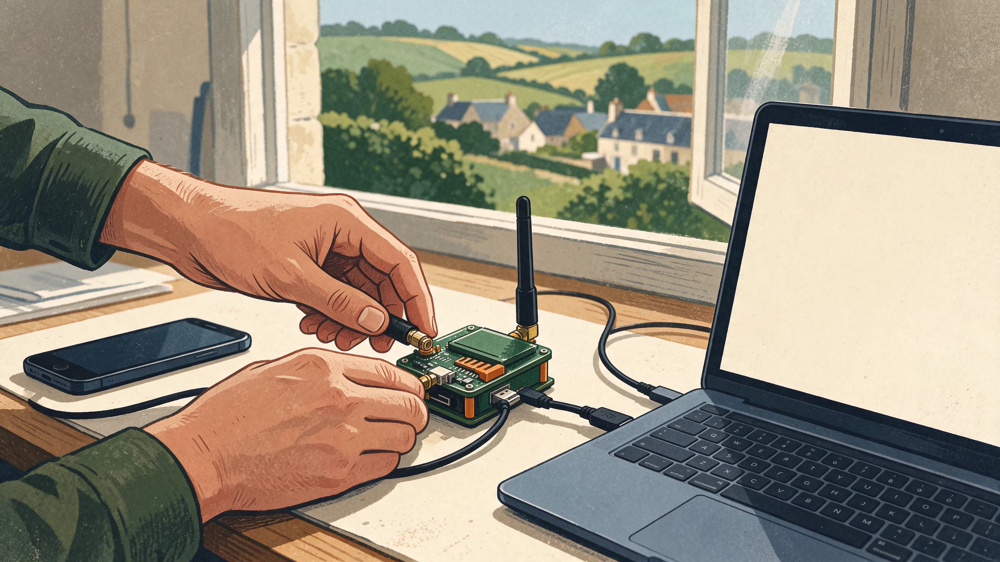
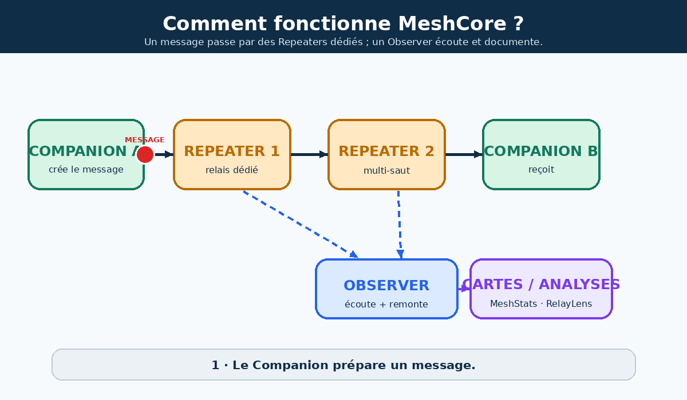

# MeshCore — démarrage rapide

## Comprendre MeshCore

MeshCore est un firmware et un ensemble d’outils open source pour créer des réseaux LoRa à routage multi-sauts. Son approche utilise des rôles explicites et des clients dédiés. Il ne faut pas supposer qu’un nœud MeshCore rejoint directement un réseau Meshtastic.

Le Projet d’Interconnexion Normand migre progressivement vers MeshCore. Pendant cette transition, certains nœuds peuvent encore fonctionner sous Meshtastic. Vérifiez le logiciel utilisé par le groupe ou le relais que vous souhaitez rejoindre avant de flasher votre appareil.

### Lire le schéma en quelques secondes

1. Le **Companion A** est l’appareil utilisé par une personne pour créer et recevoir des messages.
2. Le message est transmis par radio LoRa à un **Repeater**, puis éventuellement à un autre Repeater : ce sont les relais dédiés qui construisent l’infrastructure multi-sauts.
3. Le **Companion B** reçoit le message lorsque le chemin radio est disponible. La portée dépend du terrain, des antennes, de la hauteur et de la configuration ; le schéma ne promet pas une distance fixe.
4. Un **Observer** écoute les nœuds et les paquets qu’il peut recevoir, puis peut remonter des données autorisées vers des cartes et outils comme MeshStats ou RelayLens. Il n’est pas représenté comme un relais supplémentaire : son rôle principal est l’observation et la collecte.

La version structurée du dessin est disponible en [source Mermaid](../assets/meshcore-fonctionnement.mmd). Le GIF est volontairement simplifié : il explique les rôles et le trajet général sans remplacer la configuration réelle, les tests de portée ou la documentation du firmware.

### Qui émet et comment un message direct trouve son chemin ?

L’application remet le message au **Companion** : c’est sa radio qui l’émet en LoRa. Au premier échange avec un contact, un message direct peut partir en *flood* (diffusion par les relais). Le destinataire renvoie un accusé de livraison qui indique les Repeaters traversés; le Companion mémorise ce chemin. Les messages directs suivants peuvent alors le suivre : chaque Repeater ne retransmet le paquet que si son identifiant correspond à l’étape prévue. Si le chemin ne fonctionne plus, le Companion peut réessayer en flood pour en découvrir un autre.

Un message envoyé sur un **canal** n’a pas un destinataire unique : il est diffusé en flood à chaque envoi. Les Companions ne relaient pas les messages des autres par défaut; seuls les Repeaters ou Room Servers configurés pour répéter assurent ce rôle. Un *scope* peut limiter certains floods à une région. Voir la [FAQ MeshCore](https://docs.meshcore.io/faq/) et le [format des paquets](https://docs.meshcore.io/packet_format/).

## 1. Vérifier la compatibilité

Consultez le [Web Flasher officiel MeshCore](https://flasher.meshcore.io/) et identifiez le modèle exact de votre carte. Une variante proche n’est pas forcément compatible. Préparez un câble USB de données et branchez l’antenne avant d’alimenter la radio.

## 2. Flasher

Utilisez le [Web Flasher officiel MeshCore](https://flasher.meshcore.io/). Choisissez le matériel puis le rôle : **Companion**, **Repeater** ou **Room Server**. N’utilisez pas un binaire trouvé dans une conversation sans vérifier sa provenance.

## 3. Connecter un Companion

Après le flash, reliez le nœud à l’application MeshCore par BLE, USB ou Wi-Fi selon le matériel. Les clients officiels et les liens à jour sont référencés dans le [dépôt MeshCore](https://github.com/meshcore-dev/MeshCore).

Un Companion est le meilleur point d’entrée pour apprendre : il permet de découvrir des nœuds, tester les messages et observer la qualité du lien sans transformer votre appareil en relais permanent.

## 4. Première conversation

Commencez par un message non sensible sur le canal public de test. Vérifiez l’identité affichée du correspondant et la présence éventuelle d’un chemin via relais. Passez aux canaux privés seulement après avoir compris la procédure de gestion des clés.

## 5. Sauvegarde et mise à jour

Notez le modèle, le rôle, la version et la date du flash. Conservez les informations d’administration hors du dépôt public. Avant une mise à jour, lisez les notes de version et prévoyez un accès physique si le nœud ne redémarre pas.

## Différence importante avec Meshtastic

Les applications, formats de configuration et rôles ne sont pas interchangeables. Pour un projet mixte, documentez séparément les canaux, les appareils et les procédures de dépannage. Une passerelle entre systèmes doit être traitée comme un composant de sécurité et de fiabilité, pas comme un simple réglage.

## Besoin d’aide ?

Vous pouvez poser vos questions à tout moment sur le [serveur Discord officiel du Projet d’Interconnexion Normand](https://discord.gg/HnAfYUSU82) ou par e-mail à [projet.interconnection.normand@gmail.com](mailto:projet.interconnection.normand@gmail.com).
