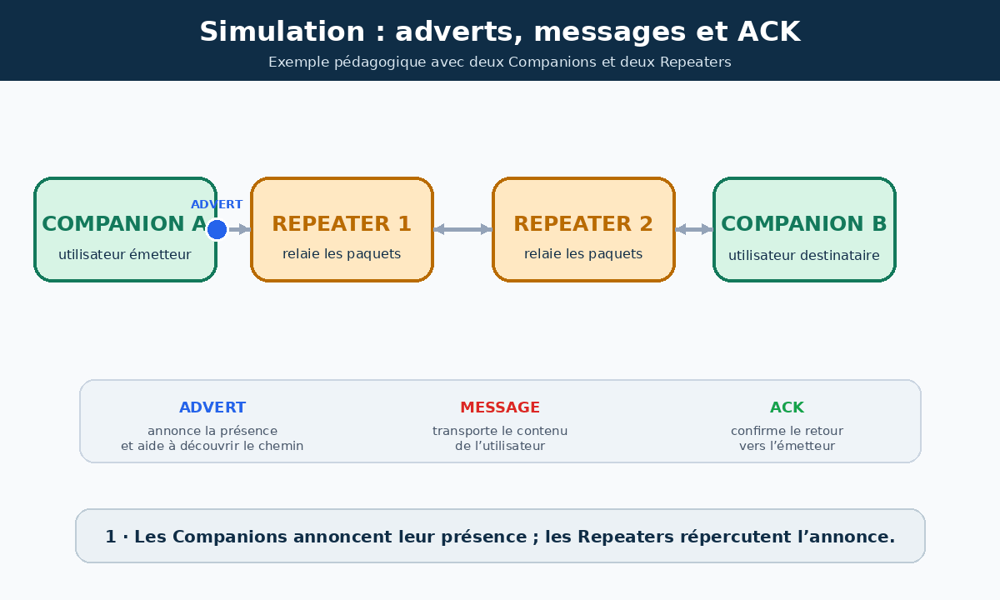

# MeshCore — rôles et déploiement

## Companion

Le Companion relie une personne au réseau. Il ne doit pas être considéré comme un relais permanent. C’est le rôle recommandé pour les premiers essais, les déplacements et la validation d’une zone et ainsi permettre de communiquer.

Bonnes pratiques : batterie surveillée, antenne adaptée, nom court non personnel et aucune clé d’administration partagée inutilement.

## Simulation : advert, message et accusé

Cette simulation représente un cas simple avec deux Companions et deux Repeaters :

1. Un **advert** annonce la présence d’un Companion ou d’un Repeater et aide les appareils à découvrir le réseau. Ce n’est pas un message utilisateur.
2. Un **message** transporte le contenu envoyé par l’utilisateur. Il passe de saut en saut par les Repeaters disponibles sur le chemin.
3. Un **ACK** (accusé) revient vers l’émetteur pour confirmer la réception lorsque le protocole et le chemin le permettent.
4. Les Repeaters relaient les paquets ; les Companions restent les appareils utilisés par les personnes et ne deviennent pas automatiquement des relais pour le trafic des autres.

La séquence est volontairement représentative : les temporisations, chemins, limites de flood, annonces et conditions d’accusé dépendent de la version du firmware et de la configuration du réseau. La [source Mermaid](../assets/meshcore-adverts-messages.mmd) décrit la topologie simplifiée.

## Repeater

Le Repeater relaie les paquets pour étendre la couverture. Il mérite un emplacement dégagé, une alimentation stable et un responsable identifié. Avant installation, obtenez l’autorisation du propriétaire du site, évaluez les risques de foudre et prévoyez une récupération physique.

Un relais n’est pas automatiquement meilleur parce qu’il émet plus. La hauteur, le bruit radio, l’antenne, la ligne de vue, le refroidissement et la congestion comptent davantage. Mesurez avant et après installation.

## Room Server

Le Room Server héberge des échanges de type salon selon les capacités de la version installée. Il doit être traité comme un service : responsable, sauvegarde, contrôle d’accès si disponible, procédure d’arrêt et journal des changements.

## Fiche de déploiement

Avant mise en service, renseignez dans un emplacement privé :

- identifiant du site et coordonnées approximatives ;
- propriétaire et autorisation ;
- modèle, firmware et antenne ;
- alimentation et autonomie estimée ;
- accès physique et méthode de récupération ;
- date du dernier test ;
- mainteneur et remplaçant.

Ne publiez pas publiquement l’adresse exacte d’un relais privé. Le wiki peut publier une zone générale ou un identifiant de site si cela ne fragilise pas l’installation.

## Maintenance

Planifiez un contrôle périodique : tension, température, boîtier, connecteurs, état de l’antenne, journal de redémarrage et version logicielle. Toute modification doit être testée sur un appareil de laboratoire avant déploiement quand c’est possible.

## Besoin d’aide ?

Vous pouvez poser vos questions à tout moment sur le [serveur Discord officiel du Projet d’Interconnexion Normand](https://discord.gg/HnAfYUSU82) ou par e-mail à [projet.interconnection.normand@gmail.com](mailto:projet.interconnection.normand@gmail.com).
