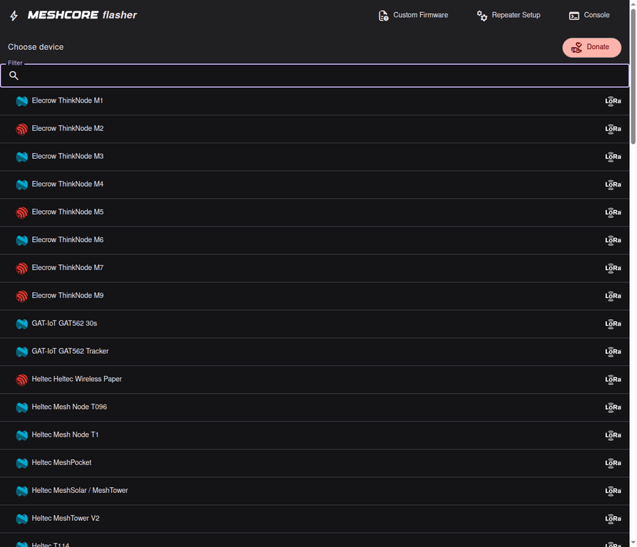
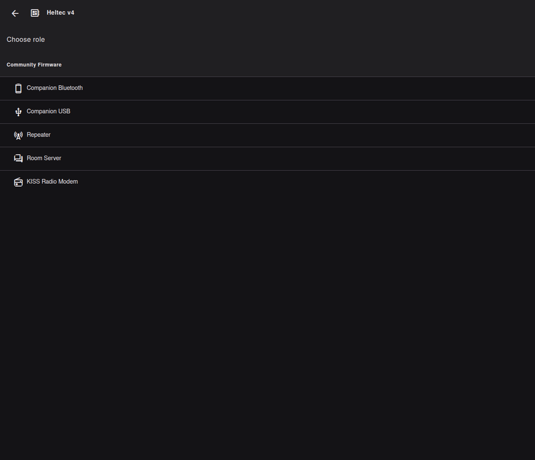
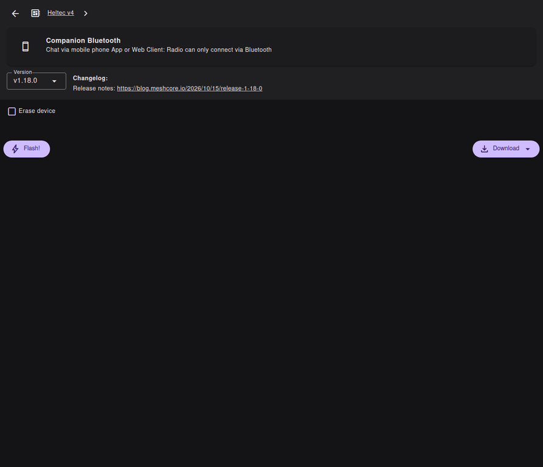
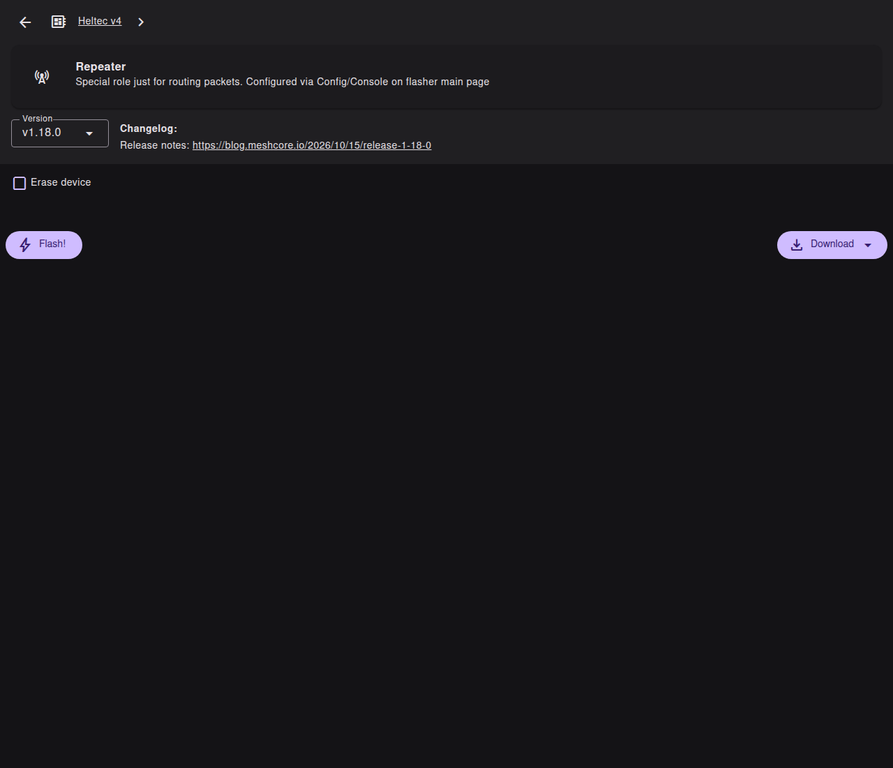

# Flasher son appareil MeshCore

Ce guide explique comment installer MeshCore sur un appareil LoRa compatible. Il distingue deux usages :

- **Companion** : votre nœud personnel, relié au téléphone ou à l’ordinateur ;
- **Repeater** : un répéteur permanent, installé pour étendre la couverture.

Pour le Projet d’Interconnexion Normand, un nouveau membre doit commencer par un **Companion**. Le rôle **Repeater** est réservé à un appareil dédié, un emplacement autorisé et une personne chargée de la maintenance.

## Avant de commencer

Préparez un ordinateur équipé d’un navigateur compatible Web Serial, de préférence Chrome ou Chromium, un câble USB de données, l’appareil LoRa, son antenne et une alimentation stable. Un câble USB de recharge uniquement ne fonctionnera pas.

Vérifiez le modèle exact de la carte dans le [Web Flasher officiel MeshCore](https://flasher.meshcore.io/). Une carte qui ressemble à votre modèle peut utiliser une autre puce ou une autre mémoire. Ne sélectionnez pas un modèle “proche”.



*Exemple visuel avec une carte Heltec v4. Votre liste peut être différente : sélectionnez toujours le modèle imprimé sur votre appareil.*

Branchez l’antenne avant d’alimenter la radio. Retirez les autres appareils USB qui pourraient utiliser le même port série. Fermez les applications de terminal, PlatformIO, Arduino IDE ou tout autre programme qui pourrait bloquer le port.

## Sauvegarder avant de flasher

Si l’appareil fonctionne déjà, notez son rôle, son nom, sa version, sa fréquence, son profil radio, son scope, ses canaux et son emplacement. Exportez la configuration lorsque l’application le permet, mais ne publiez jamais cet export : il peut contenir des clés, des mots de passe ou des identifiants.

Un flash peut effacer la configuration précédente. Considérez toujours l’opération comme une remise à zéro potentielle.

# Partie 1 — Flasher un Companion

## Quand choisir Companion ?

Choisissez **Companion** pour votre premier appareil, pour un nœud porté avec vous ou pour un appareil relié à l’application MeshCore. Le Companion permet d’envoyer et de recevoir des messages, de découvrir des répéteurs et de tester la couverture. Il n’est pas un répéteur permanent.

## Étape 1 — Ouvrir le flasher

1. Ouvrez le [Web Flasher MeshCore](https://flasher.meshcore.io/).
2. Branchez l’appareil avec le câble USB de données.
3. Autorisez le navigateur à accéder au port série.
4. Sélectionnez le modèle exact de l’appareil.
5. Choisissez le firmware **Companion**.
6. Choisissez BLE si le téléphone doit se connecter en Bluetooth, ou USB Serial si l’appareil sera relié par câble à un ordinateur ou à un client compatible.



*Pour un nœud personnel, choisissez « Companion Bluetooth » ou « Companion USB ». Le bouton « Repeater » est réservé au relais permanent.*

Ne débranchez pas l’appareil pendant l’effacement ou l’écriture du firmware. Si le navigateur affiche un journal, conservez-le uniquement après avoir retiré les clés, adresses privées et informations sensibles.

## Étape 2 — Premier démarrage

Après le flash, redémarrez l’appareil si le flasher le demande. Ouvrez l’application MeshCore ou le client Web officiel [app.meshcore.nz](https://app.meshcore.nz/), puis connectez le Companion par BLE ou USB selon le firmware choisi.



*Vérifiez la version affichée, laissez « Erase device » activé uniquement si vous acceptez l’effacement, puis cliquez sur « Flash! ».*

Donnez au nœud un nom court qui ne révèle pas votre nom complet, votre adresse ou votre position. Vérifiez que l’antenne est bien connectée et que l’appareil ne chauffe pas anormalement.

## Étape 3 — Réglage radio normand

Pour rejoindre le réseau MeshCore du Projet d’Interconnexion Normand, utilisez le profil annoncé par les mainteneurs :

```text
Fréquence : 869.618 MHz
Bande passante : 62.5 kHz
Spreading Factor : 8
Coding Rate : 8
```

Dans les interfaces qui utilisent une commande radio :

```text
set radio 869.618,62.5,8,8
```

La fréquence et les paramètres radio doivent correspondre au réseau que vous voulez rejoindre. Ne mélangez pas ce profil MeshCore avec l’ancienne configuration Meshtastic `869.525 MHz / LongFast`.

## Étape 4 — Réglage du scope

Pour un Companion normand, le scope par défaut du projet est `fr`. Activez les chemins sur deux octets dans les réglages de l’application lorsque votre version et le réseau sont compatibles avec ce choix.

Choisissez ensuite le scope du canal selon l’usage : `fr` pour `#fr`, `fr-nor` pour les canaux normands communs et le scope départemental pour un canal local comme `#potes`.

## Étape 5 — Test du Companion

Faites un premier test à quelques mètres d’un autre appareil MeshCore connu. Envoyez un message court et non sensible. Vérifiez que le nœud est visible, que le message est reçu et que le chemin est cohérent.

Puis testez dans un second emplacement. Notez le modèle, le firmware, le profil radio, le scope, l’antenne et le résultat. Pour contribuer à la couverture, consultez le [guide de test radio](../terrain/01-test-radio.md) et la [carte des nœuds](../map.html).

# Partie 2 — Flasher un Repeater

## Quand choisir Repeater ?

Choisissez **Repeater** uniquement si vous voulez installer un relais permanent. Il faut un emplacement autorisé, une antenne adaptée, une alimentation fiable, un boîtier approprié et une personne qui pourra intervenir physiquement.

Un Repeater n’est pas un Companion plus puissant. Il a un rôle différent et doit être configuré, testé et maintenu comme une petite infrastructure.

## Étape 1 — Préparer le site et le matériel

Avant le flash, vérifiez l’autorisation du propriétaire du site, la hauteur, la sécurité électrique, la protection contre l’eau, le vent, la foudre, la chaleur et le vol. Préparez une solution de récupération USB ou un accès physique.

Utilisez un appareil dédié. Ne transformez pas votre seul Companion en Repeater sans prévoir un autre appareil pour communiquer avec le réseau pendant la maintenance.

## Étape 2 — Flasher le firmware Repeater

1. Ouvrez le [Web Flasher officiel MeshCore](https://flasher.meshcore.io/).
2. Branchez le Repeater par USB avec un câble de données.
3. Sélectionnez le modèle exact.
4. Choisissez le firmware **Repeater**.
5. Lancez l’effacement et l’installation.
6. Attendez la fin complète du flash et ne débranchez pas l’appareil pendant l’opération.
7. Redémarrez lorsque le flasher le demande.



*L’écran Repeater affiche le rôle, la version et le bouton « Flash! ». La configuration du relais se fait ensuite via la console ou le configurateur.*

Pour la configuration par console USB, le [configurateur MeshCore](https://config.meshcore.io/) et la fonction console du flasher peuvent être utilisés selon le matériel et la version installée.

Pour le matériel solaire Seeed, consultez aussi la page dédiée au [SenseCAP Solar Node P1-Pro](06-sensecap-p1-pro.md). Le P1-Pro vendu pour MeshCore est généralement livré pré-flashé en Repeater.

## Étape 3 — Appliquer la configuration normande

L’exemple suivant est prévu pour un répéteur situé dans le **Calvados**. Chaque équipe doit adapter les scopes à son département et aux départements réellement couverts :

```text
set radio 869.618,62.5,8,8
set advert.interval 240
set flood.advert.interval 24
set agc.reset.interval 4
set multi.acks 1
set dutycycle 10
set path.hash.mode 1
set loop.detect minimal
set flood.max.unscoped 5
set flood.max.advert 6
region def eu fr fr-nor fr-14 fr-50 fr-61
region default fr
region home fr
region save
reboot
clock sync
```

Pour un autre département, remplacez ou adaptez les scopes départementaux. Les codes utilisés par le projet sont `fr-14` pour le Calvados, `fr-50` pour la Manche, `fr-61` pour l’Orne, `fr-76` pour la Seine-Maritime et `fr-27` pour l’Eure.

Un répéteur ne doit déclarer des départements voisins que s’il reçoit réellement des nœuds ou des répéteurs de ces zones. Ajouter un scope ne crée pas une couverture radio.

La version détaillée et les explications de chaque commande sont dans [Profils MeshCore France / Normandie](03-profils-france-normandie.md) et [Régions et scopes](04-regions-et-scopes.md).

## Étape 4 — Nom, position et accès

Définissez un nom de répéteur qui indique sa zone générale sans publier une adresse privée. Si la position est nécessaire à la cartographie, utilisez une position publique approximative et vérifiez qu’elle ne met pas le site en danger.

Changez les mots de passe par défaut lorsque la version et le rôle les utilisent. Ne partagez jamais un mot de passe d’administration dans une issue GitHub, un canal public ou une capture d’écran.

## Étape 5 — Test avant installation

Testez le Repeater sur table avec un Companion. Vérifiez la radio, les annonces, les paquets reçus, les statistiques, la température et l’alimentation. Testez ensuite depuis plusieurs directions autour du futur site.

Après installation, comparez la couverture réelle avec la simulation. Un répéteur doit être placé haut, dégagé, accessible et suffisamment éloigné des sources de bruit radio. La hauteur et l’antenne comptent souvent davantage qu’une puissance supplémentaire.

## Étape 6 — Maintenance

Notez le modèle, la version, le rôle, le profil radio, les scopes, l’antenne, l’alimentation, le propriétaire du site et le responsable de maintenance. Gardez une sauvegarde hors ligne et un plan de récupération.

Surveillez périodiquement les statistiques radio, les paquets, l’autonomie et les redémarrages. Annoncez les changements de fréquence, de scope ou de firmware avant de les appliquer.

## Dépannage du flash

- **Le port n’apparaît pas :** essayez un autre câble USB de données, un autre port et fermez les logiciels qui utilisent le port série.
- **Le flash échoue immédiatement :** vérifiez le modèle exact, le navigateur et le mode USB de la carte.
- **L’appareil ne répond plus :** débranchez, attendez quelques secondes, rebranchez avec l’antenne installée et relancez le flasher officiel.
- **Le nœud est visible mais aucun message ne passe :** vérifiez région, fréquence, bande passante, SF, CR, scope et canal.
- **Le Repeater est visible mais ne relaie pas :** vérifiez son rôle, son alimentation, ses annonces, ses statistiques et la configuration des régions.

Si vous êtes bloqué, demandez de l’aide sur le [serveur Discord du Projet d’Interconnexion Normand](https://discord.gg/HnAfYUSU82) ou par e-mail à [projet.interconnection.normand@gmail.com](mailto:projet.interconnection.normand@gmail.com). Ne publiez pas de clé privée, mot de passe, QR code, adresse exacte ou export complet de configuration.
