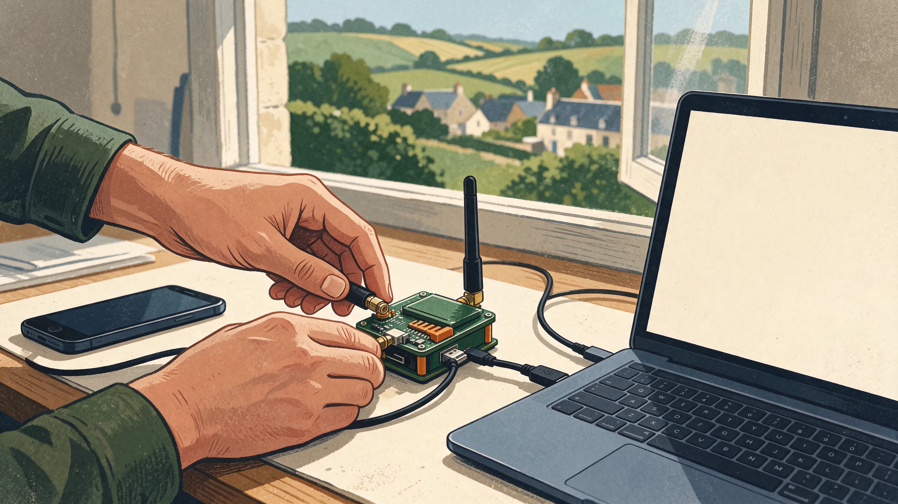

# Meshtastic — démarrage rapide



## Ce que vous allez faire

Vous allez installer le firmware, connecter l’appareil, définir la région, choisir le preset utilisé par le projet, puis envoyer un premier message de test.

## 1. Installer le client

Utilisez l’application officielle Meshtastic pour Android, iOS/iPadOS/macOS, ou l’interface Web officielle. Pour les opérations répétables, la CLI Python peut être installée avec :

Pour installer ou mettre à jour le firmware depuis un navigateur, utilisez le [Web Flasher officiel Meshtastic](https://flasher.meshtastic.org/). Branchez l’appareil en USB avec un câble de données et sélectionnez le modèle exact.

```bash
python3 -m pip install --upgrade meshtastic
```

Le nom exact des menus peut évoluer. La documentation officielle reste la référence pour la version installée.

## 2. Connecter le nœud

Allumez l’appareil avec son antenne installée. Connectez-le par Bluetooth ou USB. Donnez-lui un nom court et identifiable, sans utiliser votre nom complet ni votre adresse.

## 3. Définir la région

Dans les réglages LoRa, choisissez la région européenne prévue par le firmware pour votre emplacement en France. Ne laissez pas la région sur `UNSET` et ne choisissez pas `US` en Europe. Le choix régional contrôle la plage de fréquences et les limites appliquées par le firmware.

En CLI, la forme générale est :

```bash
meshtastic --set lora.region EU_868
```

Vérifiez toujours la valeur proposée par la version du firmware et la réglementation en vigueur avant émission.

## 4. Choisir le preset du projet

Un nœud n’entend correctement que les nœuds qui partagent la même région et un preset modem compatible. Le projet doit publier son choix dans [02-configuration-projet.md](02-configuration-projet.md). Si la page indique **À valider localement**, demandez le preset au groupe avant de modifier votre appareil.

Ne changez pas le preset d’un relais en production sans fenêtre de maintenance annoncée.

## 5. Régler le rôle

Pour un premier appareil, utilisez le rôle **Client**. Les rôles Repeater ou Router sont réservés aux appareils dédiés, avec alimentation, emplacement et maintenance maîtrisés.

### Qui émet et comment le message progresse ?

L’application prépare le message, mais c’est la **radio Meshtastic** qui l’émet. Meshtastic n’utilise pas un itinéraire fixe enregistré à l’avance : il diffuse le paquet par *managed flooding*. Les nœuds qui l’entendent attendent brièvement pour voir si un autre l’a déjà retransmis. Si le paquet peut encore avancer, ils le relaient et diminuent son **hop limit** (le nombre maximal de retransmissions). Cette limite borne la diffusion; le destinataire peut recevoir le paquet pendant qu’il se propage.

Le rôle du nœud détermine s’il aide à relayer : un **Client** retransmet si aucun autre nœud ne l’a déjà fait; un **Router** ou **Repeater** retransmet chaque paquet admissible une fois; un **Client Mute** ne relaie pas. Le chemin réel dépend donc des radios qui s’entendent au moment de l’envoi, pas d’une liste fixe de relais. Voir l’[algorithme officiel](https://meshtastic.org/docs/overview/mesh-algo/) et les [rôles des appareils](https://meshtastic.org/docs/configuration/radio/device/).

## 6. Premier test

À deux endroits connus, envoyez un message court sur le canal prévu. Notez l’heure, la distance approximative, la présence d’obstacles et le nombre de relais. Un seul message reçu ne constitue pas une mesure de couverture.

## 7. Sauvegarder

Exportez la configuration si le client le permet et conservez-la hors dépôt public. Une configuration peut contenir des clés et des identifiants. Ne publiez jamais l’export complet dans une issue ou une capture d’écran.

## Dépannage express

- Aucun nœud visible : vérifier antenne, alimentation, région, preset et canal.
- Nœuds visibles mais messages illisibles : vérifier le nom du canal et la PSK.
- Portée faible : tester l’emplacement, l’orientation et l’antenne avant d’augmenter quoi que ce soit.
- Appareil muet après flash : vérifier le modèle exact et refaire la procédure officielle de récupération.

## Besoin d’aide ?

Vous pouvez poser vos questions à tout moment sur le [serveur Discord officiel du Projet d’Interconnexion Normand](https://discord.gg/HnAfYUSU82) ou par e-mail à [projet.interconnection.normand@gmail.com](mailto:projet.interconnection.normand@gmail.com).
