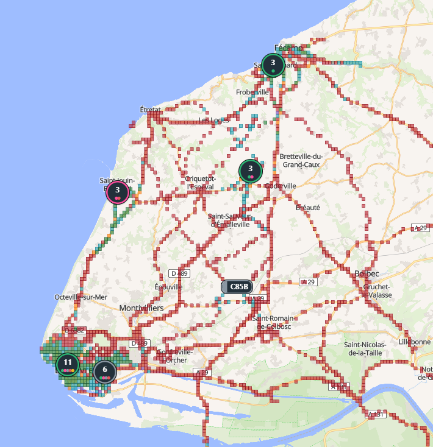

# Tests radio de terrain et wardriving

Un test radio permet de décrire ce qui a été observé à un endroit, avec un matériel et une configuration donnés. Il ne prouve pas qu’une commune entière est couverte et ne garantit pas qu’un message passera lors d’un prochain essai. Le relief, les bâtiments, les arbres, l’antenne, la hauteur, le bruit radio, le trafic et les conditions du moment peuvent changer le résultat.

Dans ce guide, le **wardriving** désigne un parcours à pied ou en véhicule pendant lequel on relève les nœuds entendus et la qualité des liaisons. Il ne s’agit pas de rechercher des réseaux Wi-Fi. Pour un parcours motorisé, la personne qui conduit ne manipule jamais le téléphone ni la radio : confiez le suivi à un passager ou arrêtez-vous dans un lieu sûr.

## Choisir la bonne méthode

Pour une mesure contrôlée, utilisez deux appareils compatibles et convenez d’un canal et d’un horaire de test. Déplacez un seul appareil à la fois et relevez les points où les messages sont reçus. Cette méthode convient pour comparer une antenne, une hauteur ou deux emplacements, à condition de ne modifier qu’un seul paramètre entre les essais.

Pour cartographier progressivement les observations d’un réseau **MeshCore**, l’application [MeshMapper](https://wiki.meshmapper.net/app_getting_started/) connecte un Companion MeshCore au téléphone et associe les observations radio à la position GPS. L’application Android et iOS peut se connecter au Companion en Bluetooth ou TCP ; la connexion USB est disponible sur Android. Les résultats contribuent aux cartes communautaires de [MeshMapper](https://meshmapper.net/). MeshMapper est conçu pour **MeshCore, pas pour Meshtastic**. Vérifiez les appareils et versions pris en charge dans son [guide officiel de démarrage](https://wiki.meshmapper.net/app_getting_started/).

Le **module Range Test de Meshtastic** est une autre méthode. Il demande un nœud émetteur fixe et un nœud récepteur qui enregistre les messages, éventuellement avec les positions GPS. Ce module est distinct de MeshMapper et ne rend pas les deux systèmes interopérables. Meshtastic avertit que ces émissions répétées occupent le canal et peuvent ralentir le réseau : activez-les uniquement pour un essai convenu, puis désactivez-les dès la fin du test ([documentation officielle Range Test](https://meshtastic.org/docs/configuration/module/range-test/)).

## Préparer un essai reproductible

Avant de partir, notez le logiciel et sa version, le modèle de chaque appareil, le firmware, le profil radio, le canal ou scope utilisé, l’antenne et son emplacement, la source d’alimentation ainsi que le rôle de chaque nœud. Vérifiez que les appareils utilisent des paramètres compatibles. Ne modifiez pas la configuration d’un relais en service pour un essai improvisé.

Choisissez une zone où vous êtes autorisé à vous rendre. Pour un essai comparatif, gardez le même nœud de référence, la même antenne et les mêmes réglages. Chargez les batteries, vérifiez que les antennes sont raccordées avant d’alimenter les radios et assurez-vous que le téléphone obtient une position GPS exploitable. Notez la météo et les obstacles principaux : bâtiment, bois, vallée, haie dense ou relief masquant.

Commencez par un point de contrôle proche, où la communication devrait fonctionner. Éloignez ensuite le nœud mobile par étapes, en vous arrêtant à des points faciles à retrouver. À chaque arrêt, envoyez plusieurs messages courts non sensibles ou effectuez la mesure prévue par l’application. Notez ce qui a été reçu dans chaque sens, le délai approximatif, le nombre de relais observés ainsi que les valeurs RSSI ou SNR lorsqu’elles sont disponibles. Une seule réception ne constitue pas une mesure fiable.

Pour comparer deux emplacements, répétez le même parcours dans l’autre sens ou à un autre moment. Indiquez alors la différence de conditions. N’attribuez pas une amélioration à l’antenne si vous avez aussi déplacé le nœud, changé le profil radio et modifié le canal.

## Utiliser MeshMapper pendant un parcours MeshCore

MeshMapper est une application de wardriving et de cartographie communautaire du réseau MeshCore. Pour un parcours en ligne, il faut un Companion MeshCore compatible, le téléphone avec le GPS activé et une région MeshMapper disponible. Les régions doivent être configurées sur le service. En mode hors ligne, l’application peut enregistrer localement des observations en Passive ou Trace, mais les pings de canal flood — Send Ping, Active et Hybrid — ne sont pas disponibles. Suivez le [guide de connexion](https://wiki.meshmapper.net/app_connection_guide/) si le Companion n’apparaît pas.

*Exemple de relevé MeshMapper fourni par le projet, autour du Havre. Les cellules représentent des observations faites pendant les parcours ; elles ne décrivent pas une couverture uniforme et ne garantissent pas qu’une liaison fonctionnera à chaque endroit.*

Après connexion, choisissez le mode en fonction de l’objectif et de l’autorisation donnée par les responsables locaux :

- **Passive** observe le trafic entendu et envoie des requêtes de découverte à zéro saut. Il n’émet pas les messages de canal qui inondent le mesh, mais ce n’est pas un mode totalement silencieux.
- **Trace** teste la liaison vers un répéteur identifié. Il est utile pour comparer un emplacement ou l’orientation d’une antenne vers ce nœud précis.
- **Hybrid** alterne entre découverte et messages de canal. Il fournit davantage de types d’observations, mais certains messages sont propagés par les répéteurs et utilisent du temps d’antenne. N’utilisez ce mode que si le trafic de wardriving est autorisé dans la région.
- **Active** envoie principalement des messages de canal répétitifs. La documentation MeshMapper le conserve pour compatibilité et recommande plutôt Hybrid ; il est rarement nécessaire pour un premier relevé.

Un résultat **DISC** ou **TRACE** signifie qu’un répéteur a répondu à une requête ciblée ; **RX** signifie que l’application a entendu du trafic sans avoir transmis à cet endroit. Un résultat **BIDIR** indique une interaction dans les deux sens. **TX** ne signifie pas que votre radio a reçu un écho : il indique que le message est passé par le mesh sans retour entendu par l’appareil. Les catégories **DEAD** ou **DROP** décrivent des résultats défavorables sur ce ping précis, pas une conclusion définitive sur toute la zone. Consultez la page officielle [Understanding Visuals](https://wiki.meshmapper.net/visuals/) pour l’interprétation à jour des marqueurs.

Pour limiter le trafic, commencez par Passive ou Trace. N’activez pas Hybrid ou Active sans vérifier les règles du réseau local, la portée du scope et la disponibilité des créneaux d’émission. L’application peut appliquer des paramètres propres à la région ; ne les contournez pas.

## Confidentialité et publication des traces

MeshMapper utilise la position GPS pour associer les observations à la carte. Dans une session envoyée au service, les positions et mesures contribuent à des cartes publiques. Par défaut, les coordonnées ne sont pas incluses dans les messages radio de wardriving : elles sont transmises par l’application au serveur MeshMapper. Cela ne rend pas les données anonymes sur la carte. Le mode « Anonymous » masque le nom public dans certains affichages, mais ne supprime pas l’association de la session au matériel ni la position cartographiée. Le [mode hors ligne](https://wiki.meshmapper.net/app_connection_guide/) permet de conserver les données localement sans les téléverser tant que vous ne choisissez pas de le faire. Lisez la [politique de confidentialité MeshMapper](https://wiki.meshmapper.net/privacy/) avant d’envoyer une session.

Ne cartographiez pas le domicile d’un particulier, un lieu sensible ou l’emplacement exact d’un relais privé sans accord. N’activez pas la diffusion radio de vos coordonnées. Pour partager un bilan local, préférez une carte généralisée ou une description par secteur lorsque la précision n’est pas nécessaire. Ne publiez jamais de clés, QR codes de configuration, données personnelles ou captures contenant des identifiants privés.

## Comprendre et présenter les résultats

Une carte de mesures montre des observations réalisées par des appareils précis, pas une promesse de service. Les marqueurs dépendent du mode, des nœuds actifs, de leur configuration et de la date du relevé. La portée la plus éloignée affichée ne signifie pas que tous les points intermédiaires sont couverts, ni qu’un autre appareil obtiendra le même résultat.

Dans un compte rendu, séparez les faits observés des hypothèses. Indiquez la période du test, les appareils, le profil radio, les antennes, les emplacements approximatifs, les obstacles et les limites rencontrées. Si vous comparez deux configurations, précisez exactement le paramètre changé. Une simulation peut aider à choisir où tester, mais elle ne remplace pas une mesure réelle.

Arrêtez l’émission répétée à la fin de l’essai et remettez les appareils dans leur configuration d’usage. Un résultat négatif est également utile s’il est décrit avec ses limites ; il ne permet pas, à lui seul, d’affirmer qu’un secteur ne sera jamais couvert.

## Sources et documentation

- [MeshMapper — Getting Started](https://wiki.meshmapper.net/app_getting_started/) et [Wardriving Modes](https://wiki.meshmapper.net/app_wardriving_modes/)
- [MeshMapper — Connection Guide](https://wiki.meshmapper.net/app_connection_guide/), [Understanding Visuals](https://wiki.meshmapper.net/visuals/) et [Privacy Policy](https://wiki.meshmapper.net/privacy/)
- [Meshtastic — Range Test Module](https://meshtastic.org/docs/configuration/module/range-test/)
