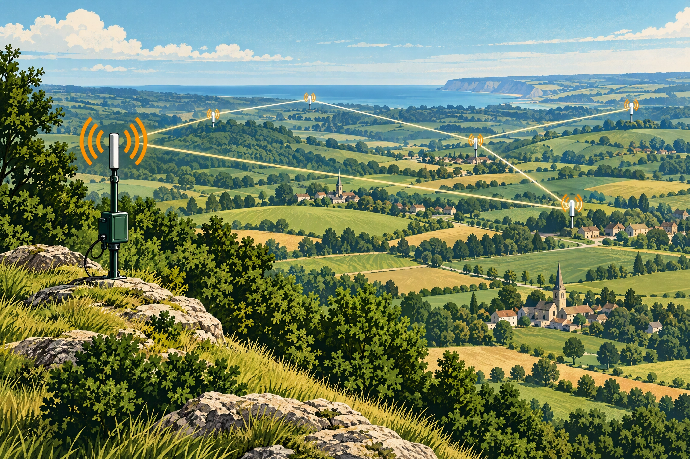
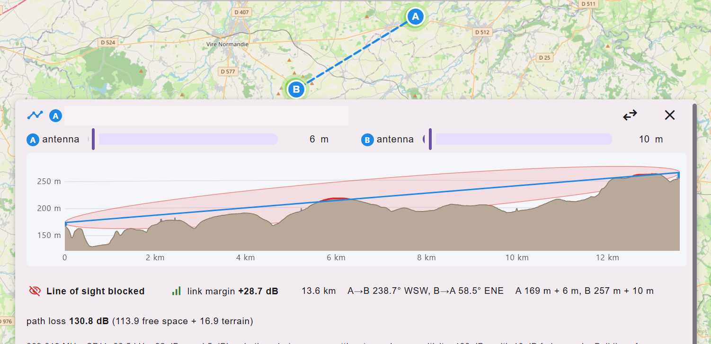

# Où installer son nœud ?

Un bon emplacement n’est pas forcément le point le plus haut disponible. Il faut combiner hauteur, visibilité radio, accès autorisé, alimentation, sécurité, météo et possibilité de maintenance.

> **Vous avez trouvé un spot ?** Partagez une photo non sensible ou demandez un avis sur le [Discord officiel du projet](https://discord.gg/HnAfYUSU82). Vous pouvez aussi écrire à [projet.interconnection.normand@gmail.com](mailto:projet.interconnection.normand@gmail.com) avant d’installer votre nœud.

## Pour un Companion

Portez le nœud avec l’antenne dégagée du corps et des objets métalliques. En véhicule, éloignez l’antenne de l’électronique bruyante et utilisez une fixation stable. À pied, évitez de l’enfermer au fond d’un sac ou dans une boîte métallique. Pour cartographier une zone, gardez le téléphone et le Companion connectés en Bluetooth et notez les endroits où les messages ou adverts sont reçus.

## Pour un Repeater

Cherchez une hauteur utile avec une ligne de vue vers plusieurs zones, pas seulement un sommet isolé. Évitez les cages métalliques, murs en béton armé, gaines techniques et toitures qui masquent l’horizon. Vérifiez l’accès, l’accord du propriétaire, la résistance au vent, la mise à la terre et la protection contre l’eau.

Un relais placé trop près d’une source de bruit radio ou avec une mauvaise alimentation peut être moins utile qu’un nœud plus bas mais mieux dégagé.

## À 868 MHz : garder la zone de Fresnel dégagée

La **ligne de visée géométrique** est le segment direct entre les antennes. Pour une liaison radio, ce segment ne suffit pas à décrire le trajet : l’onde occupe aussi un volume autour de lui, appelé **première zone de Fresnel**. Un relief, un bâtiment ou une végétation qui pénètre dans ce volume peut atténuer ou faire varier le signal, même si les deux antennes semblent se voir. À l’inverse, une liaison peut parfois encore fonctionner lorsque le relief masque le segment direct, grâce à la diffraction, mais avec des pertes qui dépendent de la forme et de la position de l’obstacle.

En pratique, on cherche généralement à dégager au moins **60 % du rayon de la première zone de Fresnel** sur l’ensemble du trajet. À 868 MHz, la longueur d’onde est d’environ 34,5 cm. Le rayon varie avec la fréquence et avec les distances de part et d’autre de chaque point : `r₁ = √(λ × d₁ × d₂ / (d₁ + d₂))`, avec les distances en mètres. À titre d’exemple, pour une liaison de 13,6 km, le rayon au milieu du trajet est d’environ **34 m** ; la marge de dégagement de 60 % représente environ **21 m** autour de la ligne directe à cet endroit. C’est un ordre de grandeur géométrique, pas une hauteur d’antenne universelle : le profil réel, le relief et les obstacles comptent tout au long du trajet. Voir aussi la [recommandation ITU-R P.526-16](https://www.itu.int/dms_pubrec/itu-r/rec/p/R-REC-P.526-16-202511-I!!PDF-E.pdf) sur la diffraction et la note [Line of Sight Obstruction de Campbell Scientific](https://s.campbellsci.com/documents/au/technical-papers/line-of-sight-obstruction.pdf).

*Exemple de profil Vire–Vassy : environ 13,6 km, avec des antennes indiquées à 6 m et 10 m. Le profil signale que la ligne de visée directe est masquée, mais l’outil affiche une marge calculée de +28,7 dB : une obstruction géométrique n’implique donc pas nécessairement une absence totale de signal. Cette valeur reste une estimation du modèle, ni une mesure radio de terrain ni une garantie de liaison. Les coordonnées précises et l’identifiant du répéteur ont été masqués dans la capture.*

## Méthode en cinq étapes

1. Dessiner la zone à couvrir et les utilisateurs prioritaires.
2. Tester deux ou trois points avec une simulation.
3. Comparer hauteur, antenne et terrain, pas seulement la puissance.
4. Installer temporairement et faire un test radio réel.
5. Publier la couverture observée avec ses limites, jamais une promesse absolue.

## Outils de simulation et de couverture

- **[Meshtastic Site Planner](https://site.meshtastic.org/)** : placez un émetteur sur la carte, choisissez un appareil ou réglez la radio, puis lancez la simulation.
- **[MeshLab-RF — projet de 1234LUCIUS](https://github.com/1234LUCIUS/meshlab-rf/)** : simulateur local pour comparer Meshtastic et MeshCore, le relief, le bâti, la végétation, les antennes, les relais, les pertes et la charge réseau. Il ne remplace pas une mesure terrain.
- **[MeshMapper](https://meshmapper.net/)** : application mobile de wardriving MeshCore et carte communautaire de mesures de couverture. Elle collecte des observations GPS associées aux signaux entendus ou aux réponses des répéteurs ; ce sont des mesures de terrain, pas une simulation ni une garantie de couverture. Consultez le [guide de test radio et wardriving](01-test-radio.md) et la [politique de confidentialité MeshMapper](https://wiki.meshmapper.net/privacy/) avant de téléverser des traces.
- **[mapme.sh](https://mapme.sh/)** : carte communautaire de couverture MeshCore. Elle permet de visualiser des mesures de terrain agrégées et d’enregistrer des parcours depuis un Companion compatible.
- **[MeshMap](https://meshmap.net/)** : carte communautaire de nœuds Meshtastic visibles via MQTT. La présence d’un nœud dépend de sa politique de position et de sa connexion éventuelle à Internet.
- **[Calculateur LoRa de Semtech](https://www.semtech.com/design-support/lora-calculator)** : outil de bilan radio ; utile pour comprendre la sensibilité et le compromis débit/portée.

## Section “Antenna coverage” dans l’application MeshCore

L’application MeshCore propose une fonction de couverture d’antenne lorsqu’elle est disponible pour la version et le client utilisés. Ouvrez la section **Antenna coverage** ou l’outil de cartographie associé, connectez votre Companion par Bluetooth et réalisez un trajet en gardant le GPS du téléphone actif. Consultez aussi [mapme.sh](https://mapme.sh/), qui documente le fonctionnement du mapping et les niveaux RSSI.

Les couleurs de couverture sont des mesures locales, pas une garantie pour tout appareil. Un changement d’antenne, de hauteur ou de profil radio peut modifier le résultat.

## Confidentialité

Pour une carte publique, publiez une zone ou une cellule approximative plutôt que les coordonnées exactes d’un domicile. N’ajoutez jamais de clé privée, mot de passe, QR code ou détail qui faciliterait l’accès à un relais.

## Une question ?

Vous pouvez à tout moment rejoindre le [serveur Discord officiel du Projet d’Interconnexion Normand](https://discord.gg/HnAfYUSU82) ou nous contacter par e-mail à [projet.interconnection.normand@gmail.com](mailto:projet.interconnection.normand@gmail.com).
